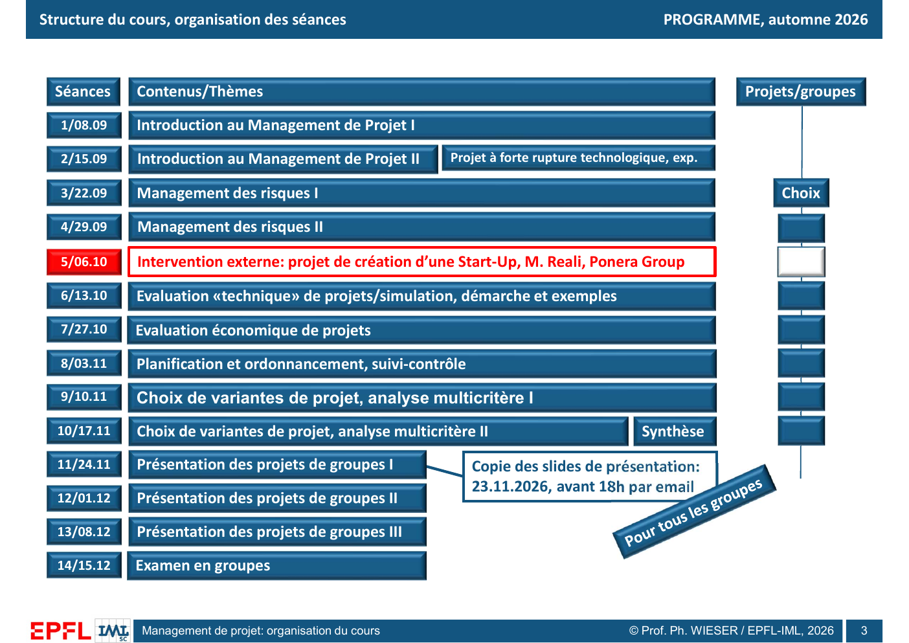
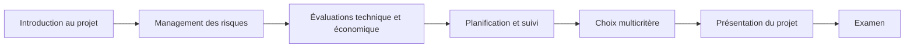
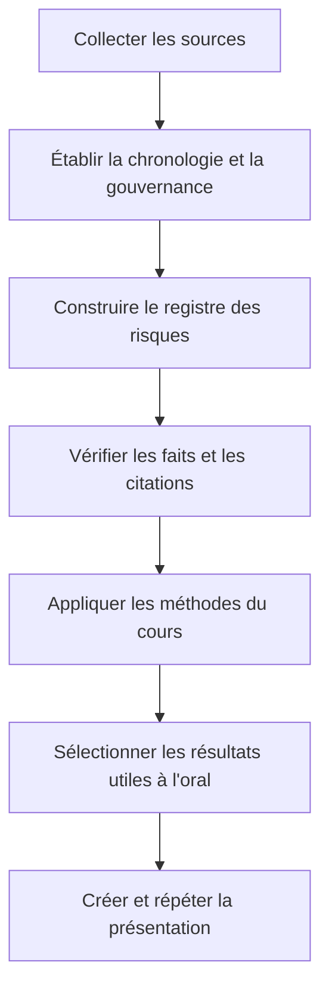

# Organisation du cours MGT-427

## Rôle de cette fiche

Cette fiche suit l'unique [PDF d'organisation](../slides/0_MGT_427_organ_26.pdf) présent dans le dossier du cours. Le fichier correspond à l'export du 21 septembre 2026. Les règles ci-dessous décrivent ce support. Les conseils de préparation sont des compléments pédagogiques.[^1]

## Structure générale du cours

Le cours comporte quatorze séances de trois heures. Le support prévoit environ deux heures de cours et une heure consacrée au projet de groupe pendant chaque séance. La note finale se partage à parts égales entre le projet et l'examen. L'examen se déroule lui aussi en groupe.[^2]

| Élément | Organisation annoncée | Conséquence pratique |
|---|---|---|
| Nombre de séances | 14 | Le cours suit une progression allant des fondements à l'analyse de variantes, puis aux présentations |
| Durée d'une séance | 3 heures | Le projet doit avancer pendant le semestre et pas seulement avant la remise |
| Répartition indicative | 2 h de cours, 1 h de projet | Les méthodes vues en cours peuvent être intégrées progressivement au cas étudié |
| Projet | 50 % de la note | La qualité de l'analyse et de la présentation compte autant que l'examen |
| Examen en groupe | 50 % de la note | La préparation doit couvrir les concepts et leur application collective |
| Présentations | Séances 11 à 13 selon le calendrier détaillé | Trois créneaux figurent dans le programme de la page 3 |
| Accès aux supports | Transmission directe et personnelle par courriel | Le canal indiqué par le PDF est le courriel individuel |

> **Interprétation probable de la diapositive.** Le découpage de chaque séance suggère que le projet sert de terrain d'application continu. Une bonne présentation ne devrait donc pas juxtaposer une histoire de l'événement et quelques outils appris en classe. Elle devrait montrer comment les outils structurent le diagnostic, les choix, le traitement des risques et le retour d'expérience.

## Calendrier de l'automne 2026

La diapositive 3 donne le calendrier suivant.[^3]

*Diapositive 3 du support d'organisation. Les mentions « Choix » et « Synthèse » figurent dans la colonne du projet de groupe.*

| Séance | Date | Contenu annoncé |
|---:|---:|---|
| 1 | 08.09 | Introduction au management de projet I |
| 2 | 15.09 | Introduction au management de projet II et exemple de projet à forte rupture technologique |
| 3 | 22.09 | Management des risques I |
| 4 | 29.09 | Management des risques II |
| 5 | 06.10 | Intervention de Matthew Reali, Ponera Group, sur un projet de création de start-up |
| 6 | 13.10 | Évaluation technique de projets, simulation, démarche et exemples |
| 7 | 27.10 | Évaluation économique de projets |
| 8 | 03.11 | Planification, ordonnancement et suivi-contrôle |
| 9 | 10.11 | Choix de variantes et analyse multicritère I |
| 10 | 17.11 | Choix de variantes et analyse multicritère II, puis synthèse |
| 11 | 24.11 | Présentation des projets de groupes I |
| 12 | 01.12 | Présentation des projets de groupes II |
| 13 | 08.12 | Présentation des projets de groupes III |
| 14 | 15.12 | Examen en groupes |

Le support indique une remise des slides le **23 novembre 2026 avant 18 h par courriel**, pour tous les groupes.[^3] Cette date doit être contrôlée contre toute annonce plus récente avant l'envoi final.

La colonne « Projets/groupes » place le **choix** à la séance 3 et la **synthèse** à la séance 10. Pour les présentations, la page 2 mentionne seulement les séances 12 et 13. Le calendrier daté de la page 3 ajoute la séance 11. La fiche retient les trois créneaux du calendrier détaillé. L'affectation de chaque groupe dépend des indications de l'enseignant.[^2][^3]

Le diagramme montre la logique pédagogique plutôt qu'une simple succession de dates. Le cours commence par définir le projet et son organisation. Il introduit ensuite les risques, puis les méthodes de décision, de planification et de comparaison. La présentation de groupe peut donc reprendre cette même progression.

> **Point à confirmer.** Le support ne précise pas la durée de chaque présentation, le nombre de slides attendu, les critères détaillés du barème ou le temps réservé aux questions. Ces paramètres devront être obtenus avant la conception du diaporama final.

## Familles de sujets proposées

Le support classe les exemples en quatre familles. L'astérisque désigne un « projet multiple » dans la légende des quatre diapositives. Le PDF n'en précise pas les modalités.[^4]

| Famille | Répertoire des exemples du PDF | Sujets marqués d'un astérisque |
|---|---|---|
| Méthodes (M1 à M8) | PRINCE2, HERMES, méthodes agiles, MERISE, choix multicritère (TOPSIS), normes et standards, formations PMI et IPMA, portefeuille de projets. | M3 |
| Risques (R1 à R10) | AMDEC, MOSAR, MADS, HAZOP, LOPA, HACCP, identification, enchaînement (dont IA), prévention, analyse des risques d'une organisation ou d'un processus. | R7, R9, R10 |
| Organisation (O1 à O14) | Organisation par métier ou sujet, changement, audit, échecs, qualité, RH, conflits, brainstorming, Delphi, communication, clôture et bilan, base de connaissances, financement, financement international. | O1 |
| Applications (A1 à A21) | Événements sportifs et culturels, projets internationaux, avant-projets de grands événements, industrie, informatique, maintenance préventive, schéma directeur administratif, urbanisme, santé, lancement de produit, qualité, sécurité, Lean (5S et Six Sigma), lancement de start-up, création de produit, innovation, transport, génie civil, systèmes d'information, transformation numérique. | A1 à A7, A10 à A14, A16 à A21 |

### Méthodes de management de projet

Les exemples cités comprennent PRINCE2, HERMES, les méthodes agiles, MERISE, TOPSIS, les normes et standards, les formations PMI et IPMA, ainsi que la gestion d'un portefeuille de projets.[^5]

Ces sujets portent sur une méthode ou un référentiel. Un groupe qui choisit cette voie doit normalement expliquer le contexte d'emploi, les rôles, le processus, les livrables, les limites et les différences avec des approches voisines. Le sujet Paris 2024 n'appartient pas directement à cette catégorie, mais il peut mobiliser plusieurs de ces méthodes comme grilles d'analyse.

### Méthodes d'analyse des risques

Le support cite les méthodes suivantes : AMDEC, MOSAR, MADS, HAZOP, LOPA et HACCP. Il propose aussi des sujets transversaux sur l'identification, l'enchaînement, la prévention et l'analyse organisationnelle des risques.[^6]

| Méthode ou thème | Question générale |
|---|---|
| AMDEC | Quels modes de défaillance peuvent affecter une fonction et comment les prioriser ? |
| MOSAR | Comment représenter et maîtriser les scénarios d'accident d'un système complexe ? |
| MADS | Comment modéliser les dangers, les flux et les cibles exposées ? |
| HAZOP | Quelles déviations par rapport au fonctionnement prévu peuvent créer un danger ? |
| LOPA | Les couches de protection indépendantes réduisent-elles suffisamment le risque ? |
| HACCP | Quels points critiques doivent être maîtrisés dans une chaîne de production ou de service ? |
| Enchaînement des risques | Comment un premier événement modifie-t-il la probabilité ou l'impact des suivants ? |
| Prévention | Quelles actions diminuent la probabilité avant l'événement ? |

Le support d'organisation ne développe pas ces méthodes. Leurs explications détaillées appartiennent à la fiche consacrée à l'analyse des risques.

### Organisation et facteurs humains

La troisième famille comprend l'organisation de projet, la conduite du changement, l'audit, les causes d'échec, la qualité, les ressources humaines, les conflits, le brainstorming, Delphi, la communication, la clôture, la capitalisation des connaissances et le financement.[^7]

Cette famille rappelle qu'un projet ne se réduit pas à un planning et à un budget. Il dépend aussi de la structure de décision, de la circulation de l'information, des compétences, des intérêts des acteurs et de la manière dont les leçons sont conservées.

### Applications

Les exemples d'application couvrent les événements sportifs et culturels, les grands événements, les projets industriels, informatiques, sanitaires ou internationaux, les lancements de produits et les transformations numériques.[^8]

La cérémonie d'ouverture des Jeux olympiques de Paris 2024 se situe au croisement de plusieurs catégories du support :

- organisation d'un événement sportif ;
- organisation d'un événement culturel ;
- avant-projet et réalisation d'un grand événement ;
- projet international ;
- projet lié à la sécurité et à la sûreté ;
- projet comportant une forte composante numérique et audiovisuelle ;
- démarche de communication et de réputation ;
- coordination d'un grand nombre d'organisations.

Ce croisement justifie une analyse systémique. Une seule méthode ne peut pas couvrir correctement les dimensions artistiques, opérationnelles, financières, humaines, politiques et sécuritaires.

## Ce que le projet de groupe doit démontrer

> **Interprétation probable de la diapositive.** La liste des sujets ne constitue pas un plan de présentation. Elle montre plutôt les types d'objets que le cours considère comme analysables par les méthodes de management de projet.

Pour le cas Paris 2024, le travail devrait apporter quatre niveaux de valeur.

1. **Établir les faits.** Reconstituer le périmètre, la gouvernance, les décisions, les contraintes, les incidents et les résultats à partir de sources vérifiables.
2. **Structurer le projet.** Définir les objectifs, les acteurs, les phases, les dépendances, les ressources et les mécanismes de suivi.
3. **Analyser les risques.** Identifier les événements redoutés, leurs causes, leurs impacts, les mesures documentées et les risques résiduels.
4. **Porter un jugement argumenté.** Distinguer ce qui a été bien anticipé, ce qui a été mal maîtrisé et ce qui reste impossible à conclure avec les informations publiques.

La qualité du quatrième niveau dépend des trois premiers. Une opinion forte ne compense pas une base factuelle faible.

## Stratégie de préparation

Le calendrier suggère un ordre de travail qui réduit le risque de produire un diaporama séduisant mais fragile.

Cette séquence place la vérification avant l'analyse finale. Elle évite deux erreurs fréquentes : appliquer une méthode à des faits mal établis et sélectionner trop tôt une narration que les preuves ne soutiennent pas.

### S'entraîner à l'examen en groupe

**Complément pédagogique.** Prenez un cas fictif court. Chaque personne propose d'abord une réponse, puis le groupe décide quelle hypothèse retenir et comment la vérifier. Une bonne réponse relie une donnée du cas à un outil, à un résultat et à une décision. Entraînez-vous aussi à expliquer une limite du résultat à voix haute.

| Question de révision | Fiche à utiliser |
|---|---|
| Qui décide, quel besoin est mesuré, quelles variantes sont possibles ? | [Introduction](01-introduction-au-management-de-projet.md) |
| Quel événement menace l'objectif, comment le coter et le traiter ? | [Analyse des risques](02-analyse-des-risques.md) |
| Quelle preuve permet de passer du prototype au pilote puis au déploiement ? | [Cas Ponera](03-intervention-gestion-de-projet.md) |
| Quelle variante crée le plus de valeur au taux retenu ? Que change l'incertitude ? | [Évaluation économique](04-evaluation-economique.md) |
| Quelle chaîne fixe la date de fin ? Que changent les ressources et les calendriers ? | [Planification](05-planification-de-projet.md) |

## Questions à clarifier avant le diaporama

- Quelle est la durée exacte de l'oral ?
- Combien de personnes composent le groupe ?
- Chaque membre doit-il parler ?
- Existe-t-il un nombre maximal de slides ?
- Les annexes sont-elles autorisées ?
- Le barème évalue-t-il séparément la recherche, les méthodes, la qualité visuelle et la prestation orale ?
- Le fichier doit-il être envoyé en PowerPoint, en PDF ou dans les deux formats ?
- Les sources doivent-elles apparaître sur chaque slide ou uniquement dans une bibliographie finale ?

Ces questions ne bloquent pas la recherche. Elles deviennent nécessaires au moment de transformer l'analyse en présentation.

## Couverture des diapositives

| Diapositive | Contenu | Section de cette fiche |
|---:|---|---|
| 1 | Page de titre | Rôle de cette fiche |
| 2 | Structure générale, notation et accès aux supports | Structure générale du cours |
| 3 | Programme, jalons du projet, remise et calendrier des présentations | Calendrier de l'automne 2026 |
| 4 | Sujets portant sur les méthodes | Méthodes de management de projet |
| 5 | Sujets portant sur les risques | Méthodes d'analyse des risques |
| 6 | Organisation, RH et thèmes associés | Organisation et facteurs humains |
| 7 | Applications et exemples de projets | Applications et choix du sujet Paris 2024 |

## Références

[^1]: Philippe Wieser, [*Management de projet, organisation du cours*](../slides/0_MGT_427_organ_26.pdf), diapositives 1 à 7. Les métadonnées identifient la présentation `0_MP_Organi2_2026.pptx`, exportée le 21 septembre 2026.
[^2]: Philippe Wieser, [structure du cours et accès aux supports](../slides/0_MGT_427_organ_26.pdf#page=2), diapositive 2.
[^3]: Philippe Wieser, [programme d'automne 2026](../slides/0_MGT_427_organ_26.pdf#page=3), diapositive 3.
[^4]: Philippe Wieser, [exemples de sujets](../slides/0_MGT_427_organ_26.pdf#page=4), diapositives 4 à 7.
[^5]: Ibid., diapositive 4.
[^6]: Ibid., diapositive 5.
[^7]: Ibid., diapositive 6.
[^8]: Ibid., diapositive 7.
