# Innovation industrielle et entrepreneuriat : le cas Ponera

L'intervention de Matthew Reali, cofondateur de Ponera, utilise l'emballage industriel pour expliquer comment une jeune entreprise valide un besoin, finance les étapes de développement, industrialise un produit et facilite son adoption. Le support est daté du 6 octobre 2026. Les références aux diapositives indiquent les pages du PDF. Les chiffres attribués à Ponera proviennent de la présentation de l'entreprise. Les encadrés **Complément pédagogique** expliquent les mécanismes ou proposent des calculs illustratifs. Ils ne restituent pas le commentaire oral.[^1]

Pour une révision rapide, concentrez-vous sur les jalons et les preuves à financer (§ 3), la qualification industrielle (§ 4) et les calculs de rotation et de seuil de réemploi (§ 5). Les autres sections donnent le contexte commercial et logistique du cas.

## 1. Passer d'un emballage jetable à un flux de réemploi

### Le diagnostic porte sur le processus entier

La présentation s'ouvre sur des machines, pièces lourdes et ensembles de formes différentes protégés par des palettes, des caisses sur mesure et du film. Dans le processus Bühler « actuel » dessiné, la planification lance les achats, la fabrication des pièces et l'assemblage. En parallèle, l'entreprise doit acheter les matériaux d'emballage, faire fabriquer le conditionnement et le manutentionner ou l'entreposer. Les deux flux doivent converger à temps pour emballer la machine. L'aval produit un déchet d'emballage chez le client. Les difficultés repérées sont les frais indirects, la livraison à temps (*on-time delivery*, OTD), la surface d'entrepôt, les quantités de matière et la durée de manutention.[^2]

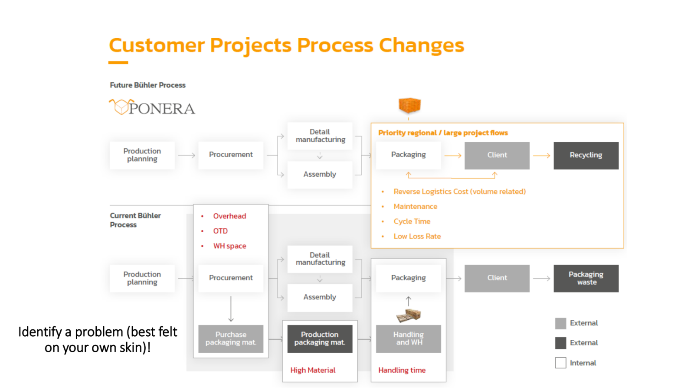

*Figure 1. Dans le schéma prospectif, les modules reviennent de chez le client vers l'emballage et rejoignent le recyclage en fin de vie. Le coût de retour dépend du volume. La maintenance, le temps de cycle et un faible taux de perte conditionnent le résultat. Le support cible en priorité des flux régionaux ou de grands projets.*[^2]

La variante présentée vise à découpler l'approvisionnement d'emballage de la planification de production. Des modules standards disponibles en stock permettent de configurer des palettes et caisses pour des dimensions différentes. Le visuel de briques de la diapositive 20 traduit cette modularité. Le processus visé diminue les frais indirects et augmente la flexibilité. Le produit doit cependant rester compatible avec les engins de manutention, les charges et les opérations existantes. Le goulot peut se déplacer vers la récupération des modules, leur remise en état ou leur disponibilité au moment d'emballer.[^2][^3]

La proposition associe le matériel réutilisable, un service de vente ou de location et, en extension, des prestations fondées sur l'activité et les données. Les diapositives montrent des essais sur plusieurs types de charges et des zones d'activité en Amérique du Nord, en Europe et en Inde. Ponera cite des transports de pièces de plus de 15 000 kg, sept entreprises ou davantage ayant un chiffre d'affaires de 1 à 30 milliards de dollars, et quinze ou davantage ayant plus de 10 millions de dollars de dépenses d'emballage. Ces derniers chiffres caractérisent les entreprises citées, pas le chiffre d'affaires de Ponera ni le volume de contrats fermes.[^4]

### Ce que mesurent les chiffres d'impact

| Indication du support | Lecture et vérification nécessaires |
|---|---|
| 17 milliards CHF, pictogrammes CO₂ avec 80 % et connectivité avec moins de 1 %, puis 30 % de la consommation mondiale de bois | Les diapositives 4 et 5 illustrent l'ampleur revendiquée du problème. Les dénominateurs des pictogrammes et le périmètre des 17 milliards ne sont pas explicités. La part de bois est une affirmation du support, sans méthode indiquée. |
| −95 % de bois, −90 % de CO₂e, et −90 % de coût emballage et transport | Les diapositives 8 et 9 comparent la solution à des emballages conventionnels. La fiche de la Fondation Solar Impulse lie le gain aux flux logistiques appropriés et emploie des maxima pour les réductions de déchets bois et d'émissions liées au transport. Le scénario de référence, les retours et les rotations déterminent la portée du chiffre. |
| 50 % des camions européens vides, jusqu'à 40 % de flux de conteneurs vides selon les lignes, 45 % des matériaux d'emballage à usage unique, quatre usages pour les palettes standards, 60 % des marchandises « trop rapides » | La diapositive 17 associe ces indications à des procédures douanières manuelles et à l'accumulation de stocks. Les bases de calcul sont absentes du visuel. Eurostat estime à 21,8 % les **véhicules-kilomètres** réalisés à vide en 2023 par les véhicules enregistrés dans l'UE. On ne peut pas comparer directement ce ratio à une proportion de camions ou de trajets. « Trop rapide » suppose une date de besoin en aval. |

Sources du tableau et points de comparaison.[^3][^4][^5][^6]

**Complément pédagogique.** Pour comparer les alternatives, définissez une unité fonctionnelle. Un exemple serait l'expédition d'une machine donnée, entre deux sites, protégée au même niveau, livrée à temps. Divisez les émissions de fabrication d'un module par les rotations effectivement obtenues avant sortie de flotte. Ajoutez les émissions par envoi liées aux retours, à la remise en état et à la fin de vie selon le périmètre retenu. Une expédition endommagée qui exige une nouvelle machine peut changer fortement le bilan. Mesurez aussi le taux de dommages. Appliquez le même périmètre aux deux solutions, même lorsque les postes de coûts sont payés par des acteurs différents.

### L'Internet physique ajoute des interfaces et des règles communes

L'Internet physique s'inspire du transfert de paquets de données. Il cherche à déplacer des unités de marchandises standardisées entre des acteurs et modes de transport qui peuvent se relayer. Dans les schémas du cours, des transports séparés et sous-utilisés laissent place à des chargements consolidés entre des nœuds partagés. Le réseau cible est une vision. Il demande des accords sur les formats, la manutention et l'information échangée.[^3][^7]

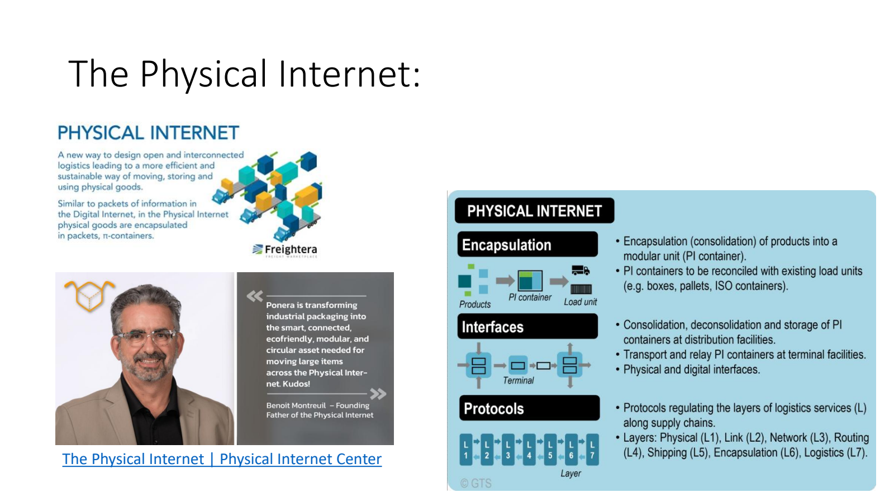

*Figure 2. L'encapsulation regroupe les produits dans une unité modulaire compatible avec les unités logistiques existantes. Les interfaces physiques et numériques servent au regroupement, au dégroupage, au stockage et au relais dans les terminaux. Les protocoles coordonnent les couches physique, liaison, réseau, routage, expédition, encapsulation et logistique. La citation de Benoît Montreuil exprime son appréciation du cas, sans constituer un essai de performance.*[^3][^7]

Le schéma « One Network » met en relation des utilisateurs des industries des machines, de l'automobile et du meuble dans plusieurs régions, notamment CH, DE et AT. Il distingue les utilisateurs ordinaires, les premiers adoptants, un promoteur du produit, des entreprises d'emballage et des logisticiens assurant stockage et transport. Il illustre un modèle de plateforme fondé sur des commissions liées à l'activité et la gestion de processus. Une nouvelle palette apporte de la flexibilité dès un premier trajet. Une flotte partagée devient plus intéressante si plusieurs acteurs acceptent les mêmes règles et disposent de points de récupération suffisamment proches.[^3]

## 2. Tester l'opportunité avant les dépenses irréversibles

### Deux points de départ et les mêmes preuves de marché

| Trajectoire | Ordre des questions | Atout possible | Risque et test prioritaire |
|---|---|---|---|
| Besoin d'abord, *problem-first* | Identifier un problème coûteux et répandu, vérifier la demande et le prix, concevoir la solution et son modèle, industrialiser et vendre. | Un besoin connu facilite la recherche de clients et peut aider à convaincre l'équipe et les investisseurs. | Observer le travail réel et les alternatives. La technologie envisagée peut changer une fois les besoins compris. |
| Technologie d'abord, *technology-first* | Développer une invention, explorer les usages, trouver des clients et un modèle, transformer la technologie en produit et industrialiser. | Une nouvelle technologie peut créer des applications ou des marchés inaccessibles auparavant. | Un cas d'usage peut être techniquement possible et insuffisamment important pour déclencher un achat. Tester plusieurs usages avec des acteurs capables de décider. |

La diapositive 14 associe la première voie à la logistique, à la finance et à la santé orientées vers un besoin, la seconde à la *deep tech*, aux nouveaux matériaux, à l'IA avancée, aux biotechnologies et au matériel. Elle privilégie la validation précoce du problème. L'infographie ne fournit pas de taux de réussite comparés permettant de mesurer l'avantage de chaque voie.[^8]

### Problème, marché, concurrence, propriété intellectuelle, solution

La diapositive 24 recommande de trouver au moindre coût les obstacles capables d'invalider le projet. Étudier les besoins avec des exploitants coûte généralement moins cher que commander un moule de série. Une expérience utile possède une hypothèse testable, un critère d'arrêt et une décision associée. Cette logique prolonge la diminution de la marge de manœuvre au cours du cycle de vie dans la [fiche d'introduction](01-introduction-au-management-de-projet.md).[^8]

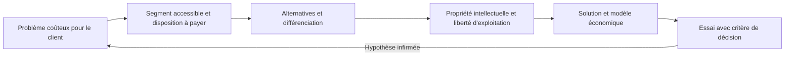

*Lecture pédagogique de la chaîne de validation. Plusieurs étapes peuvent avancer en parallèle. Un obstacle de sécurité ou de propriété intellectuelle peut nécessiter une vérification dès le début.*[^8]

- **Problème.** Identifier sa fréquence, son coût et la personne touchée. Les premiers entretiens doivent faire décrire le dernier envoi réel, la procédure et le coût, avant de montrer le produit. L'observation Bühler fournit une piste. Elle doit être vérifiée sur d'autres clients et d'autres flux.
- **Marché.** Distinguer la personne qui bénéficie du gain, l'équipe qui utilise la solution et le détenteur du budget. Une intention d'essai, une demande de devis, une contribution au pilote, une commande et un renouvellement constituent des preuves différentes.
- **Concurrence.** Inclure la solution actuelle, l'achat standard, l'externalisation et l'inaction. Chiffrer les coûts de changement au même titre que le prix du nouveau produit.
- **Propriété intellectuelle.** La brevetabilité concerne la possibilité de protéger une invention. La liberté d'exploitation ou FTO (*freedom to operate*) concerne les droits de tiers susceptibles de bloquer l'exploitation d'un produit ou procédé déterminé, sur des territoires donnés. Posséder son propre brevet peut coexister avec un besoin de licence sur un autre brevet. Une recherche FTO précoce peut orienter une modification technique, une licence ou l'abandon d'une variante. L'analyse doit tenir compte des revendications en vigueur, des territoires et de l'évolution de la solution.[^9]
- **Solution.** Relier la configuration matérielle et le service aux preuves disponibles. Choisir ce qui sera testé avant la décision de financer le développement.

L'infographie des causes d'échec affiche les catégories et pourcentages suivants. Besoin de marché absent, 42 %. Trésorerie épuisée, 29 à 38 %. Équipe inadéquate, 23 %. Concurrence, 19 %. Prix et coûts, 18 %. Mauvais produit et retours clients ignorés, 17 % et 14 %. Marketing insuffisant, 14 %. Désaccord entre fondateurs ou inadéquation avec les investisseurs, 13 %. Sans échantillon, méthode et possibilité de réponses multiples, ces valeurs servent à préparer des hypothèses de risque. Leur somme dépasse 100 % et le support ne permet pas de reconstituer une distribution de probabilités.[^8]

### Lire une carte de marché et un graphique concurrentiel

| Grandeur dans la convention courante | Question d'estimation |
|---|---|
| TAM, marché total adressable | Combien de ventes si l'offre pouvait couvrir toute la demande pertinente ? |
| SAM, marché accessible à l'offre | Quelle part le produit et ses canaux peuvent-ils effectivement servir, compte tenu du périmètre géographique et technique ? |
| SOM, part raisonnablement captable | Quelle part de ce marché peut être obtenue sur un horizon donné, avec la capacité, le rythme d'adoption et la concurrence ? |

**Lecture critique.** Les visuels du cas ne suivent pas tous la convention usuelle $SOM \le SAM \le TAM$. La diapositive 24 affiche environ 66,2 milliards USD pour le marché mondial, 17 milliards pour un SOM à trois ans, 8,7 milliards pour un SAM à un an, 2,6 milliards pour l'Europe et 300 millions pour le segment initial (*beachhead*). Elle affiche aussi 5,1 % de croissance annuelle attendue jusqu'en 2026, et distingue emballages standards et sur mesure, industries, gestion des flux par les clients et sous-région. La diapositive 33 affiche environ 75 milliards USD pour l'emballage industriel mondial, 22 milliards USD pour le TAM, 12 milliards USD pour le SOM, 600 millions avec signe dollar pour le SAM, puis 200 millions CHF pour les applications numériques. La diapositive 25 annonce « SAM : CHF 600 Million ». Les monnaies, horizons et libellés doivent être vérifiés séparément avant tout rapprochement. Les deux visuels de marché citent Fortune Business Insights sans livrer la méthode de passage des chiffres sectoriels à la demande réelle de Ponera.[^8][^12]

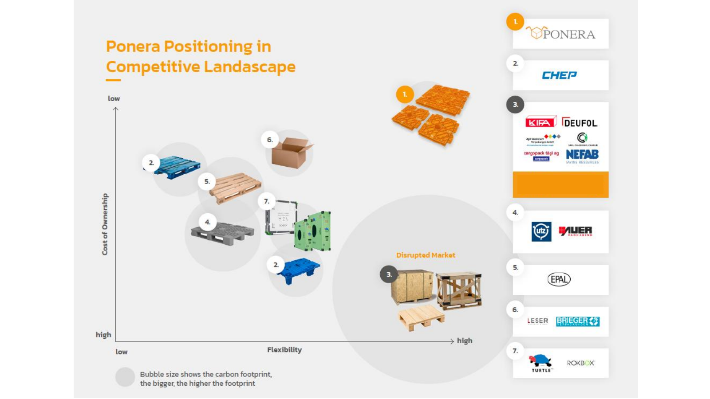

*Figure 3. Le coût de possession est élevé en bas et faible en haut. La flexibilité augmente vers la droite. La taille de la bulle représente l'empreinte carbone revendiquée. Ponera se place en haut à droite et vise notamment le marché des caisses et palettes sur mesure, flexibles mais présentées comme coûteuses et à forte empreinte. La carte montre aussi des palettes standards en bois et plastique, du carton et des caisses réutilisables. Elle exprime un positionnement de l'entreprise sans graduations chiffrées ni protocole comparatif.*[^8]

**Complément pédagogique.** Une estimation ascendante explicite les hypothèses. Si 60 sites accessibles expédient chacun 500 charges adaptées par an et que le service vaut 12 CHF par envoi, le segment représente $60 \times 500 \times 12 = 360\,000$ CHF par an. Si dix sites s'engagent et ne déploient la solution que sur la moitié des charges adaptées, le revenu illustratif devient 30 000 CHF par an. Ce calcul rend la part captée sensible à la capacité commerciale et à l'adoption, même si le marché global est important.

Le support montre la présentation du concept à l'International Physical Internet Conference de 2019. Aller au contact du marché dès le concept sert à obtenir des objections concrètes, comme des temps d'emballage incompatibles avec le poste ou une absence de flux retour. Un exposé et les retours qui suivent ne suffisent pas à démontrer une vente.[^8]

## 3. Financer le prochain résultat vérifiable

### MVP, preuve de concept et pilote

Le **MVP** (*minimum viable product*, « minimal » dans le support) est la version la plus simple qui apporte une valeur réelle. Il sert à vérifier tôt le besoin et la disposition à payer, réduire les investissements dans des hypothèses fragiles et recueillir des retours pour itérer. Le support montre des conceptions préliminaires, des rendus et des pièces jaunes avec leurs éléments de liaison. Le choix décrit consiste à commencer par un module de palette, plutôt que développer toute la caisse dès la première étape.[^10][^11]

| Épreuve | Question | Preuve possible, exemple pédagogique |
|---|---|---|
| Preuve de concept, POC | La solution peut-elle réaliser la fonction dans des conditions précisées ? | Un assemblage de modules supporte la charge d'essai et reste compatible avec les fourches. |
| Prototype | La géométrie, le montage et les interfaces répondent-ils aux exigences ciblées ? | Des opérateurs montent, démontent et manipulent un exemplaire instrumenté. |
| MVP | Une version restreinte produit-elle une valeur vérifiable pour le client ? | Un module sert à des expéditions réelles sur un flux sélectionné. Le client paie ou s'engage selon des conditions définies. |
| Pilote | L'exploitation fonctionne-t-elle de manière répétable dans un périmètre limité ? | Plusieurs rotations passent les contrôles qualité, délai et coût, avec incidents et retours tracés. |
| Déploiement | Peut-on répéter le processus pour des volumes et usages plus larges ? | Capacité, formation, maintenance, logistique retour et pièces de remplacement sont en place. |

Ces définitions opérationnelles se recouvrent parfois. Une même pièce peut constituer un prototype technique, puis servir dans un MVP si elle permet de rendre le service à un client. Le test et sa décision priment sur le nom du livrable.[^10][^11][^14]

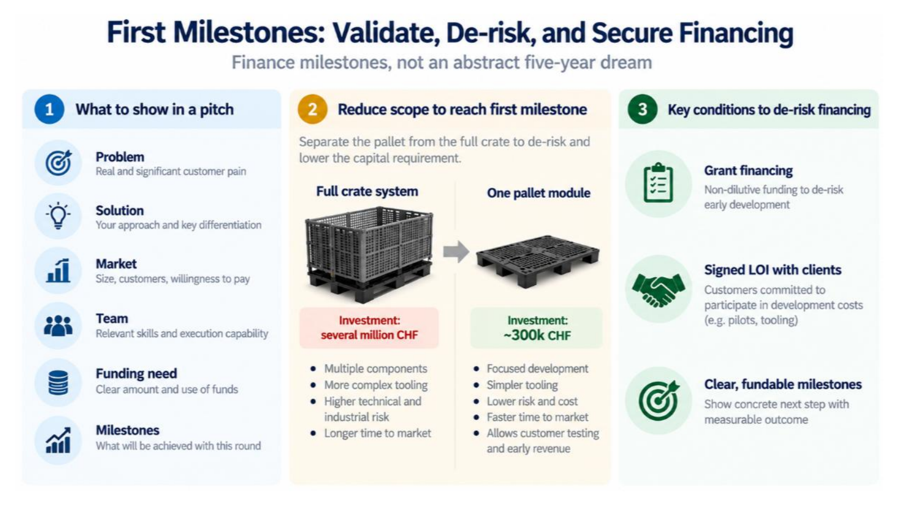

*Figure 4. La caisse complète représente un investissement présenté comme plusieurs millions de CHF. Le module seul est associé à environ 300 000 CHF, avec moins de composants, un outillage plus simple et un accès plus rapide aux tests clients. Le pitch relie problème, solution, marché, équipe, montant demandé et jalons. La figure ajoute les subventions, des lettres d'intention signées avec des clients et des résultats mesurables.*[^11]

Une lettre d'intention (*letter of intent*, LOI) matérialise un intérêt et peut préciser une participation au pilote ou à l'outillage. Sa valeur dépend des engagements concrets, de la contribution financière et des conditions. Une subvention finance une partie du développement sans cession de capital. Le plan de trésorerie doit suivre ses conditions et ses dates de versement. Une commande d'outillage peut être payée bien avant la première vente.[^11]

### Les trois phases de financement dans le cas

| Phase affichée | Montant affiché | Emploi prévu et résultat attendu |
|---|---:|---|
| Validation du marché | Cible de 500 000 CHF, 1 million CHF indiqué comme obtenu | R&D initiale, besoin en fonds de roulement pour pilotes, développement commercial, dépôts de brevets et entrées nationales. Pilotes terminés, intérêt du marché vérifié, MVP pour petits projets et expérience de constitution de la chaîne. |
| Solution complète | 1,5 + 1,5 million CHF | Construire la chaîne d'approvisionnement, poursuivre la R&D matériel et IoT, développer la distribution. Mettre en place production et chaîne, caisse complète et organisation commerciale. |
| Passage à l'échelle | 5 millions CHF | Développer la location, améliorer l'IoT et poursuivre le développement commercial. Résultat visé, modèle mixte vente-location et solutions IoT en place. |

Les diapositives 32 et 55 mettent en avant deux phases différentes de la même feuille de route. Les quelque 300 000 CHF de la figure 4 concernent le choix technique du premier module. Le tableau de financement englobe d'autres postes et ses deux dernières colonnes présentent des besoins, sans confirmation du capital levé. La diapositive d'équipe présente notamment des compétences en direction, technique, qualité, IoT, procédures et innovation de processus, nécessaires pour exécuter ces étapes.[^10][^11]

**Complément pédagogique.** En posant $T_0$ pour la trésorerie initiale, $D_t$ pour les décaissements et $E_t$ pour les encaissements du mois $t$, le solde vaut $T_t = T_0 + \sum_{i=1}^{t}(E_i-D_i)$. Si l'entreprise possède 300 000 CHF et consomme 40 000 CHF par mois, elle dispose de 7,5 mois au rythme constant. Un acompte d'outillage de 100 000 CHF réduit ce délai illustratif à cinq mois. Pour financer un jalon, il faut vérifier que le solde reste positif jusqu'au test, au traitement des écarts et à la date plausible du financement suivant. Les ventes prévues et les décaissements prévus ne se matérialisent pas nécessairement au même rythme.

## 4. Transformer un prototype en produit qualifié

### Le calcul d'injection guide le choix du moule et du procédé

L'exemple Moldex3D porte sur une pièce « Roof », variante Run02, référence MDX_0536, objectif déclaré « FPW ». Le modèle 3D montre la pièce et son système d'alimentation. La simulation aide à anticiper le remplissage et le maintien en pression, choisir la presse et estimer la déformation. Les résultats dépendent de la géométrie, de la matière, du maillage et des conditions d'injection. Une première pièce produite permet de confronter le modèle à des mesures réelles.[^13][^15]

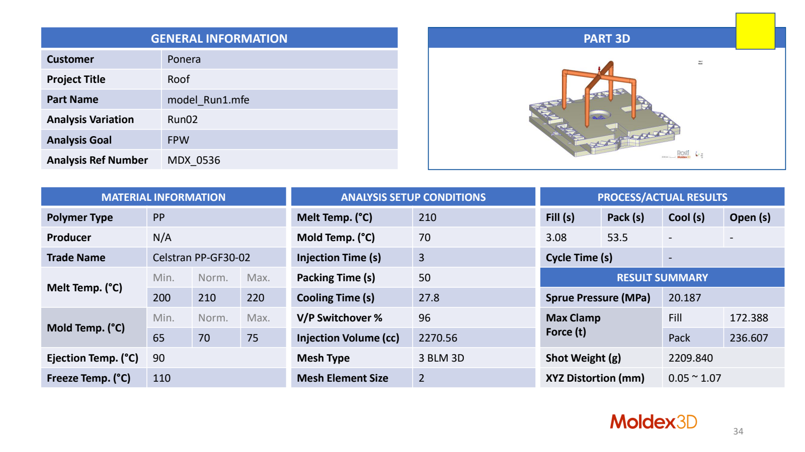

*Figure 5. La fiche distingue les paramètres choisis et les résultats de simulation. Les champs de refroidissement, d'ouverture et de durée totale du cycle sont vides dans le tableau des résultats. Additionner des durées provenant de colonnes différentes donnerait un cycle artificiel.*[^13]

| Nature | Valeur affichée | Lecture technique |
|---|---|---|
| Matière | PP, Celstran PP-GF30-02 | Le PP est un polypropylène. La désignation GF30 indique un grade renforcé de fibres de verre. Le modèle doit employer les données du grade de matière utilisé. |
| Fenêtres de température | Matière 200, 210, 220 °C. Moule 65, 70, 75 °C. Éjection 90 °C. Température dite de gel 110 °C. | Les trois premiers nombres de chaque plage sont minimum, nominal, maximum. Le scénario sélectionne 210 °C pour la matière et 70 °C pour le moule. |
| Entrées de durée | Injection 3 s, maintien 50 s, refroidissement 27,8 s. | Le maintien apporte encore de la matière sous pression pour compenser le retrait tant que l'alimentation le permet. Le refroidissement conditionne la déformation au démoulage et la cadence. |
| Autres entrées | Passage vitesse-pression à 96 %, volume injecté 2 270,56 cm³, maillage 3 BLM 3D, taille d'élément affichée 2. | Le seuil V/P définit le passage du remplissage piloté en vitesse au pilotage en pression. Le tableau ne précise pas l'unité de taille du maillage. |
| Résultats de temps | Remplissage 3,08 s, maintien 53,5 s. | Les colonnes de refroidissement, d'ouverture et de durée totale ne sont pas renseignées. |
| Pression et effort | 20,187 MPa au canal d'injection. Effort maximal de fermeture, 172,388 t au remplissage et 236,607 t au maintien. | L'effort maintient le moule fermé contre la pression de matière. La presse doit être choisie avec une marge et les unités de force du fabricant. |
| Matière et géométrie | Masse injectée 2 209,840 g. Distorsion XYZ 0,05 à 1,07 mm. | Vérifier les tolérances fonctionnelles aux interfaces, notamment autour des liaisons. L'écart admissible dépend de la pièce et du montage. |

Valeurs issues de la diapositive 34. Explication des réglages de moulage d'après la documentation technique de Moldex3D.[^13][^15]

**Complément pédagogique.** L'effort de fermeture peut être approché par $F \simeq \bar p_{\text{cavité}} A_{\mathrm{proj}}$, avec la pression moyenne dans la cavité et la surface projetée dans le plan de joint. Le calcul donne des newtons si $p$ est en pascals et $A$ en mètres carrés. La pression au canal ne remplace pas la distribution de pression dans l'empreinte. Le maintien est l'étape qui donne le maximum indiqué pour ce scénario, supérieur d'environ 37 % à celui du remplissage. Le dimensionnement ne doit donc pas se limiter à ce dernier.

### L'outillage et la qualification sont des projets à part entière

Les photos des outillages montrent des moules spécifiques, avec éléments de montage et circuits. Chaque nouveau composant ajoute des décisions de conception, une commande, des essais et une réception. Le support situe la mise en place des capacités de septembre à décembre 2020, les modules produits en janvier 2021 et les opérations industrielles en février 2021. Les photos de la première manutention, des piles de modules après itérations et des détails de fixation illustrent les étapes de maturation. La production de pièces ouvre la phase de vérification opérationnelle.[^14]

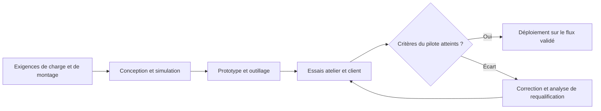

*Figure de synthèse pédagogique. Les allers-retours sont attendus pour un produit nouveau. Les changements coûteux ou qui touchent la sécurité appellent une décision explicite sur les essais à rejouer.*[^14]

La diapositive 39 indique quatre démarches avant la décision **go/no-go**. Essais en atelier, amélioration des procédures opératoires standard (SOP), tournée de collecte ou livraison répétée en Suisse (*milk run*), et projets clients. La revue POC montre des charges et configurations différentes, notamment chez KIFA et Bühler. Des conditions d'emploi diversifiées révèlent des problèmes qui peuvent rester invisibles dans un essai uniforme. Le gros plan d'une fermeture et les zones cerclées sur les modules montrent que les détails de liaison et de fabrication demandent encore des itérations. Le support ne donne pas de diagnostic écrit ni de procédure exacte pour ces deux zones.[^14]

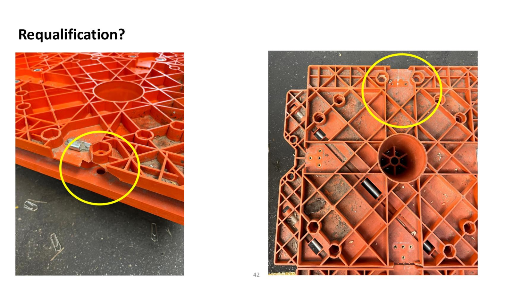

*Figure 6. La question « Requalification? » porte sur l'impact du changement. Si un verrou, une zone de fixation ou une nervure change, les essais à reprendre dépendent des fonctions touchées et de la charge réellement transmise à cette interface.*[^14]

**Complément pédagogique.** Établir un plan de qualification avant l'essai. Décrire le module, la version du moule, le grade matière, les accessoires, le chargement, les tolérances et les conditions d'usage. Vérifier l'assemblage, la tenue statique, les chocs et les vibrations, le levage, le transport, l'empilage et l'état après plusieurs rotations selon les risques du flux. Toute modification doit être associée à une analyse d'impact. Une AMDEC peut relier, par exemple, verrou mal engagé, séparation de modules, contrôle visuel et essai de manutention sous charge. La portée de la requalification dépend de ce que la modification peut invalider, pas du prix de la pièce changée. Voir la [fiche d'analyse des risques](02-analyse-des-risques.md).

Le support présente ensuite des transports de plus de 15 tonnes sur des configurations particulières. Ces photos ne définissent ni la charge statique admissible d'un module isolé ni sa charge dynamique certifiée. Les conditions d'appui, de répartition, de liaison entre modules et d'accélération sont nécessaires pour appliquer une capacité à une expédition donnée.[^14][^20]

### Construire une chaîne industrielle autour de ses postes critiques

Le schéma d'approvisionnement part des polymères et des barres d'acier pour l'injection, ainsi que des boulons et fermetures à levier pour l'assemblage. Ponera dispose des moules et un fournisseur de premier rang assure l'injection puis l'assemblage. Le stock et la livraison alimentent un entrepôt local pour la clientèle nationale et un entrepôt sous douane pour la clientèle internationale. Le support indique aussi un entrepôt dans l'UE avec identifiant douanier EORI en février 2025, et des partenaires internationaux pour l'expansion.[^19]

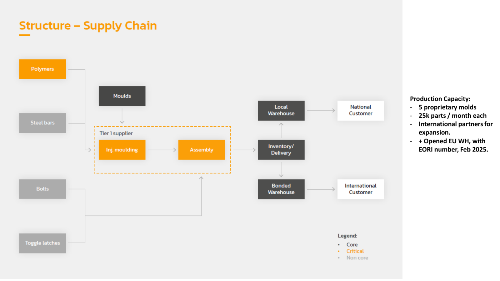

*Figure 7. Le schéma distingue les éléments au cœur de l'activité, les postes critiques et les autres composants. Le fournisseur d'injection est une dépendance même si le moule appartient à Ponera. La présence de partenaires d'expansion ne démontre pas qu'un second atelier peut reprendre immédiatement chaque référence.*[^19]

La capacité affichée est de cinq moules propriétaires et de 25 000 pièces par mois par moule. **Complément pédagogique.** Le produit arithmétique donne 125 000 pièces mensuelles de capacité nominale agrégée si les cinq moules fonctionnent en parallèle à ce rythme. La capacité en caisses dépend de la nomenclature, des machines disponibles, de la maintenance, du rendement et des opérations aval. Si une caisse exige quatre pièces d'une référence dont la sortie conforme est de 20 000 pièces par mois, ce seul poste limite la production à 5 000 caisses par mois, même si les autres pièces abondent.[^19]

Le passage de la palette à la caisse lance un nouveau cycle. Les vues CAO entourent des zones de l'interface base-paroi. Les prototypes à parois grises exposent le couvercle, le montage et les interfaces avant d'engager des volumes. Les photos de caisses sombres en atelier illustrent les POC, pilotes, déploiement et améliorations continues. La diapositive technique indique aussi des améliorations prévues après les premiers projets clients.[^20]

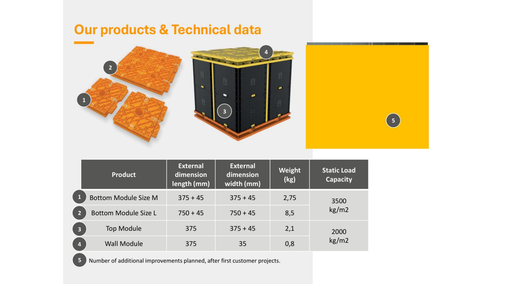

*Figure 8. Le tableau regroupe la capacité statique par familles de lignes. Les libellés produit ci-dessous suivent le tableau du support. Les numéros 3 et 4 semblent intervertis dans les pictogrammes de la caisse.*[^20]

| Module | Longueur extérieure (mm) | Largeur extérieure (mm) | Masse (kg) | Capacité statique affichée (kg/m²) |
|---|---:|---:|---:|---:|
| Base M | 375 + 45 | 375 + 45 | 2,75 | 3 500 |
| Base L | 750 + 45 | 750 + 45 | 8,5 | 3 500 |
| Dessus | 375 | 375 + 45 | 2,1 | 2 000 |
| Paroi | 375 | 35 | 0,8 | 2 000 |

Les dimensions conservent la notation de la diapositive. Une capacité exprimée en kg/m² est rapportée à une surface. Même en charge répartie, convertir en masse totale exige de connaître la surface portante et le protocole. Les efforts sur les liaisons, la flexion et le levage demandent leur propre vérification.[^20]

## 5. Vendre l'adoption, prouver la valeur chez le client

### Identifier le client et réduire le risque qu'il prend

Dans une vente interentreprises (B2B), l'acheteur peut être distinct de l'utilisateur, du bénéficiaire et du service qui autorise l'emploi. Le schéma Ponera distingue l'entreprise d'emballage (*packer*), le lieu d'emballage qui peut être celui du client ou du *packer*, le logisticien et l'utilisateur. Le *packer* ajoute un produit à son catalogue et peut gagner de la marge sur la prestation. Le logisticien manipule les flux chargés et vides. L'utilisateur modifie ses opérations. Chacun peut décider selon un coût et un risque différents.[^16]

| Levier du cours | Application au passage du pilote au contrat |
|---|---|
| Processus de décision | Identifier les interlocuteurs et le calendrier. Convenir du pilote, de l'évaluation, de la décision contractuelle et des conditions du déploiement. |
| Relations | Bâtir la confiance avec un promoteur interne. Associer technique, exploitation, commerce et direction. Rester disponible pendant le test et la mise en service. |
| Modèle économique | Simplifier l'achat ou l'usage. Comparer vente, crédit-bail, abonnement et paiement à l'usage. Réduire le coût initial si c'est l'obstacle et calculer le retour avec les postes du client. |
| Barrières d'adoption | Vérifier la compatibilité avec les processus, l'infrastructure, les exigences de sécurité et de conformité, et les systèmes informatiques. Prévoir la formation et des preuves de fiabilité. |
| Urgence | Montrer un gain mesurable, par exemple sur le coût ou les critères environnementaux et sociaux. Utiliser des pilotes limités dans le temps et les références d'utilisateurs précoces. Étudier aussi les signaux du marché, de la réglementation et de la concurrence. |

La proposition inclut l'aide à la mise en œuvre. Les écrans de la diapositive 49 montrent une application de préparation et de configuration de l'emballage. Les objectifs indiqués sont des opérations plus faciles, la sécurité de l'opérateur et des marchandises, la transparence, la standardisation et l'optimisation. Les écrans démontrent le parcours proposé. La vérification des objectifs exige des observations en situation.[^16][^17]

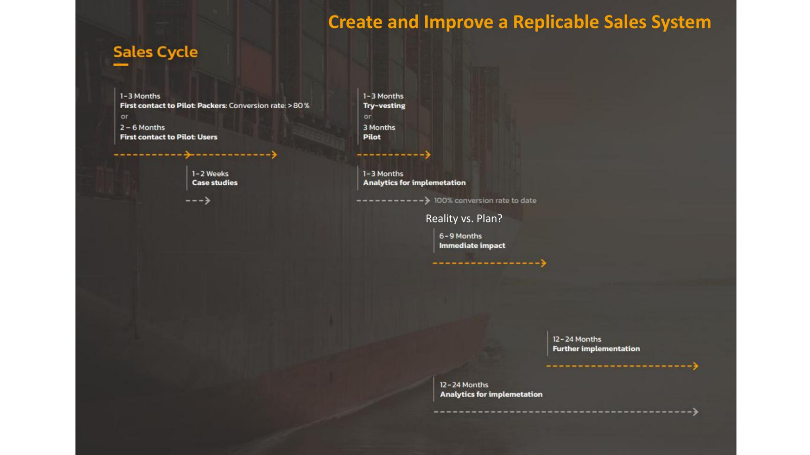

*Figure 9. La figure distingue 1 à 3 mois du contact au pilote chez les emballeurs, avec conversion annoncée supérieure à 80 %, et 2 à 6 mois chez les utilisateurs. Elle montre 1 à 2 semaines pour les études de cas, 1 à 3 mois pour l'essai « try-vesting » ou 3 mois pour le pilote, et 1 à 3 mois d'analyses de mise en œuvre. Elle juxtapose un impact dit immédiat à 6–9 mois et une poursuite de mise en œuvre et d'analyse à 12–24 mois. Le visuel mentionne aussi une conversion de 100 % à date sans préciser le dénominateur. Les flèches se chevauchent. Leur somme ne donne pas un délai contractuel.*[^16]

**Complément pédagogique.** Un système de vente reproductible trace chaque passage avec sa date, son responsable et le motif des refus. Distinguez le contact qualifié, le pilote accepté, le pilote terminé, le contrat signé et l'usage renouvelé. Une conversion calculée sur les seuls pilotes achevés renseigne sur une autre étape que la conversion de tous les contacts. Le temps nécessaire pour signer et déployer doit figurer dans les scénarios de trésorerie.

### Cas économiques présentés, Thurgovie–Bucarest et France–France

Les résultats sont des projections de cas présentées par l'entreprise. L'étude CH–RO utilise le volume 2025 majoré de 50 %, les coûts des matériaux de remplacement par unité de manutention (*handling unit*, HU) d'une table 2023, hors élimination et sans inflation, un retour à 2 000 CHF par camion complet (*full truckload*, FTL), et six cycles annuels. Elle emploie des facteurs d'émission de 64 g par tonne-kilomètre pour le camion et 15 g pour le navire, avec la notation « g/kmT » du visuel. Le financement illustré repose sur une location avec achat sur deux ans, 10 % d'apport et 3 % de coût d'achat final, sans assiette précisée. Elle retient six ans d'amortissement et 10 % de remplacement, avec un intervalle de remplacement non explicité dans le tableau.[^17]

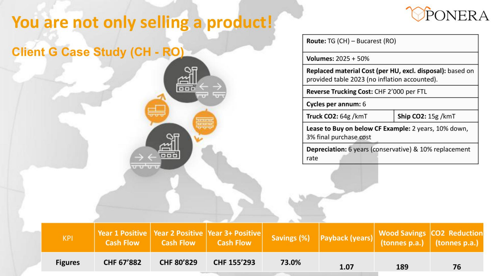

*Figure 10. Le trajet charge les unités vers le destinataire et prévoit un retour d'éléments vides. La ligne de résultats donne des flux de trésorerie positifs sur trois horizons et un délai de récupération de 1,07 an. Le détail des entrées et sorties par date n'est pas fourni.*[^17]

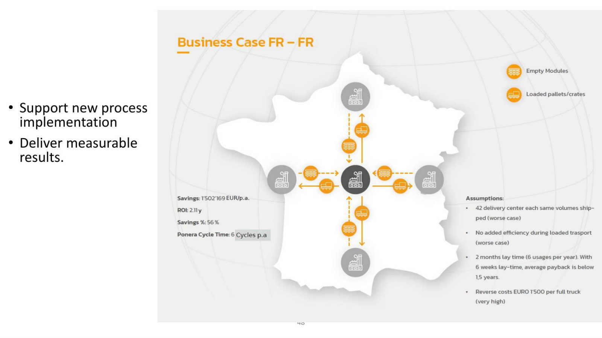

*Figure 11. Le dessin représente un réseau en étoile. Les flèches des palettes chargées vont vers les sites livrés et les modules vides reviennent au site central. Le temps d'immobilisation à chaque rotation modifie le nombre d'envois servis par la même flotte et le délai de récupération.*[^17]

| Indicateur | Client G, CH–RO | Cas France–France |
|---|---:|---:|
| Flux positifs affichés | Année 1, 67 882 CHF. Année 2, 80 829 CHF. Année 3 et suivantes, 155 293 CHF. | Économie annoncée de 1 502 169 EUR/an. |
| Économies relatives | 73,0 % | 56 % |
| Délai affiché | *Payback*, 1,07 an | « ROI », 2,11 ans. L'unité indique une durée. |
| Impact environnemental affiché | 189 t de bois économisées et 76 t de CO₂ évitées par an | Aucune quantité indiquée dans la figure. |
| Hypothèses distinctives | Six rotations et retour à 2 000 CHF par camion complet. | 42 centres à volumes égaux, aucun gain sur le transport chargé, retour à 1 500 EUR par camion complet. Deux mois d'immobilisation, six usages par an. À six semaines, délai moyen annoncé inférieur à 1,5 an. |

Le support qualifie certaines hypothèses françaises de défavorables. Sans volumes par liaison, taux de remplissage, nombre de pertes et détail des dépenses, on ne peut ni recalculer les indicateurs ni vérifier à quel point ces hypothèses sont prudentes. Les deux pourcentages s'appliquent à des scénarios distincts. Ils ne mesurent pas une réduction universelle.[^17]

**Complément pédagogique.** Si le volume annuel est $Q$ envois et que chaque ensemble réalise $r$ rotations par an, la flotte active idéale vaut environ $Q/r$. Avec $Q=600$, six rotations donnent 100 ensembles. En passant de huit à six semaines de cycle, une année de 52 semaines donne environ 8,67 rotations et un minimum théorique de 70 ensembles arrondis vers le haut. Le support associe deux mois à six rotations annuelles. Les deux conventions calendaires doivent être harmonisées dans un calcul réel. Ajouter les pointes, la réserve de maintenance, les délais de retour et la dispersion des cycles. Un ratio annuel moyen peut masquer une rupture à la semaine la plus chargée.

Avec $I$ comme coût initial par ensemble, $N$ comme nombre de rotations sur la vie utile et $c_r$ comme coût par rotation, un modèle simplifié donne $c_{\text{réemploi}}=I/N+c_r$. Pour une solution jetable à $c_j$ par envoi, le seuil est atteint si $N \ge I/(c_j-c_r)$, à condition que $c_j>c_r$. Par exemple, à $I=180$ CHF, $c_r=9$ CHF et $c_j=24$ CHF, douze rotations donnent l'égalité. Le réemploi devient strictement moins cher à partir de treize rotations. Un retour coûteux ou une casse fréquente modifie le seuil.

Le **délai de récupération** est la première date où les flux de trésorerie cumulés compensent la mise initiale, dans sa version non actualisée. Le **ROI** s'exprime usuellement par un ratio de résultat et de mise sur un horizon défini. Pour choisir entre variantes, complète le délai de récupération par le coût complet ou la VAN. Précise le traitement de l'investissement, de l'amortissement comptable, des achats de remplacement, de la valeur résiduelle, du financement et des flux effectifs. L'amortissement ne constitue pas en lui-même un décaissement. Voir aussi la fiche sur l'évaluation économique.

## 6. Le réemploi déplace le risque économique

### Achat à la demande, possession ou mutualisation

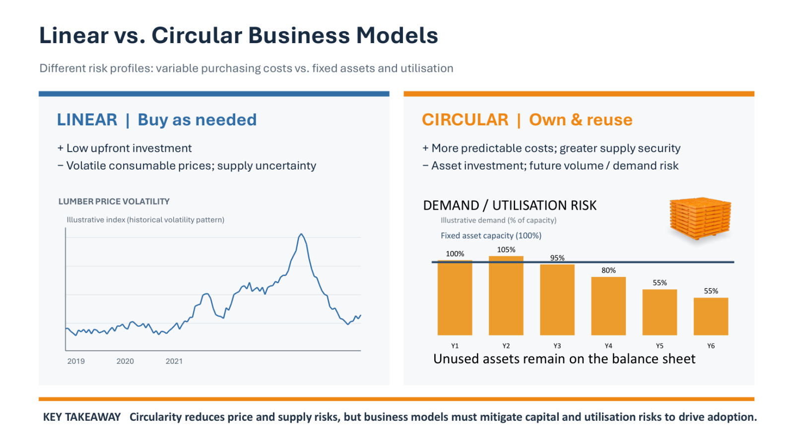

*Figure 12. À gauche, le coût des consommables varie avec le prix du bois, illustré par un indice sans échelle chiffrée. À droite, la capacité d'actifs reste fixée à 100 %. La demande illustrative vaut 100 %, 105 %, 95 %, 80 %, 55 % et 55 % de cette capacité sur six années. À 105 %, il manque des actifs pour répondre à toute la demande. À 55 %, environ 45 % de la capacité demeure inutilisée.*[^18]

Dans le modèle linéaire du support, l'entreprise achète au besoin. Elle mobilise peu de capital au départ mais reste exposée au prix et à la disponibilité du consommable. Dans le modèle circulaire en propre, elle engage une dépense d'investissement. Elle contrôle davantage la disponibilité et le coût de sa flotte. Elle supporte aussi le risque que la demande baisse, que les actifs dorment et que le coût par usage augmente. La location réduit l'engagement initial du client et transfère une partie du risque de demande vers le détenteur de la flotte.[^18]

| Modalité du cas | Ordres de grandeur illustratifs de la diapositive 52 | Risque à répartir |
|---|---|---|
| Vente ou crédit-bail | Environ 17–75 CHF par module. Délai client annoncé à partir d'un an. | Financement et disponibilité du parc. La version initiale vise notamment les charges lourdes, le système modulaire et l'analyse des flux. |
| Location | Environ 0,05–0,20 CHF par module et par jour. | Le fournisseur porte davantage le risque d'utilisation. Le client réduit sa dépense initiale. Le support associe à cette étape des accessoires, une première phase de plateforme et une ligne d'emballage standard. |
| Services de données liés à l'activité | Environ 120–750 CHF d'abonnement par utilisateur, plus environ 1 CHF par module et par an pour les services à l'activité. La périodicité de l'abonnement utilisateur n'est pas précisée. | La preuve de valeur repose sur la transparence et les gains de processus. Le support associe ce volet à une seconde phase de plateforme. |

Le tracé 80 % achat et 20 % location représente un exemple de socle et de pointe, exprimé en surface d'emballage selon le temps. L'intelligence de marché sert à adapter l'offre, anticiper les incitations et ajouter des options là où elles aident à adopter. Diversifier les utilisateurs peut lisser les pointes si leurs calendriers se compensent. Si tous ont la même saison haute, la mutualisation ne réduit guère le pic. Elle demande éventuellement de nouveaux partenaires de financement, d'entreposage ou de retour.[^18]

Les six exemples d'applications de caisses sont associés aux couples charge et prix mensuel suivants.[^18]

| Charge illustrée | Prix affiché (EUR/mois) |
|---:|---:|
| 3 t | 32,50 |
| 2,5 t | 11,50 |
| 600 kg | 7,60 |
| 250 kg | 6,70 |
| 400 kg | 9,60 |
| 750 kg | 16,50 |

La charge est une caractéristique de l'application et les cas ont des géométries différentes. Le tarif mensuel ne fournit pas à lui seul le coût par expédition. Il faut ajouter le nombre d'utilisations facturables, le retour, les accessoires et les conditions du contrat.

### La couche numérique rend la flotte exploitable

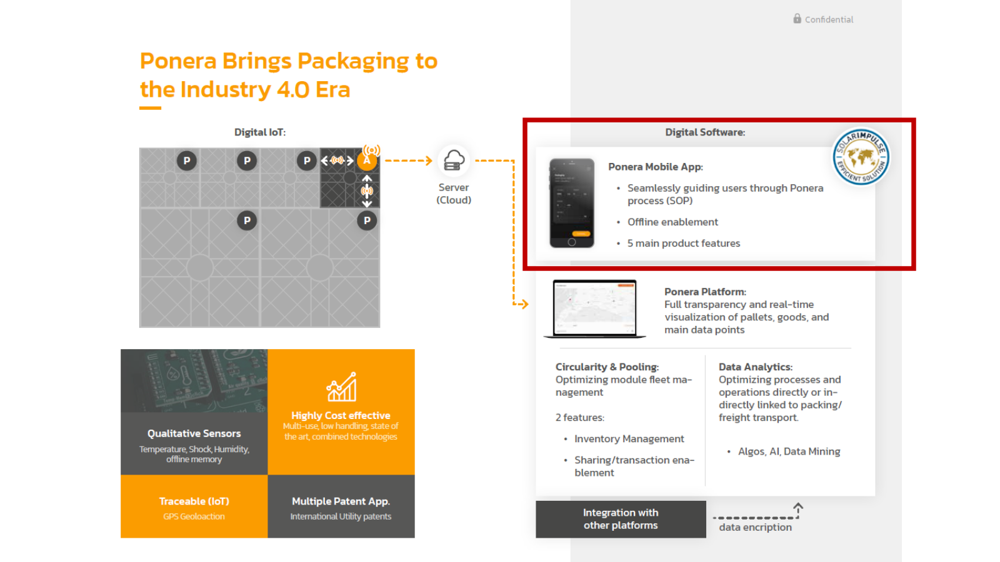

*Figure 13. Les modules communiquent avec une unité représentée comme active, un serveur cloud, l'application mobile et la plateforme. L'encadré rouge attire l'attention sur l'application et son rôle dans l'exécution des procédures opératoires.*[^20]

Le visuel distingue des capteurs de température, choc et humidité avec mémoire hors ligne, la géolocalisation GPS, des demandes de brevets et des gains de coût revendiqués grâce au réemploi et à la manutention réduite. L'application guide les utilisateurs dans les SOP, prévoit un usage hors connexion et annonce cinq fonctions principales sans les énumérer. La plateforme vise une vue temps réel des palettes, marchandises et données, la gestion d'inventaire et les transactions de partage. Le support prévoit des analyses de données, des algorithmes, l'IA, le rapprochement avec d'autres plateformes et le chiffrement des données. La présence des éléments dans le schéma décrit l'architecture proposée, sans établir la disponibilité de toutes les fonctions.[^4][^20]

**Complément pédagogique.** La localisation peut aider à récupérer une unité et à distinguer un délai de retour d'une perte. Une alerte de choc ne remplace pas la protection physique. Elle doit être associée à un seuil, une horloge, un contexte et une procédure de réponse. En zone sans réseau, la mémoire locale peut conserver les événements avant synchronisation. Le client doit savoir qui voit la localisation, quelle preuve demeure disponible après une panne et comment corriger une affectation erronée. Ces exigences relient la couche numérique au processus de réemploi.

## 7. Gouverner le projet pendant que les conditions changent

### Rôles, droits de décision et incitations

L'intervenant présente les relations entre cofondateurs comme le risque interne au plus fort impact dans son cadre de lecture. Il insiste sur l'alignement des objectifs, des valeurs, de l'engagement et de la manière de travailler. La compatibilité professionnelle doit être évaluée séparément de l'amitié. Le tableau propose les décisions concrètes suivantes.[^21]

| Acteur ou levier | Point de vigilance du support | Traduction pratique, complément pédagogique |
|---|---|---|
| Cofondateurs | Expérience et situation personnelle, rôles, capital, droits de décision, horizon et engagement. | Définir qui tranche entre lancement rapide et correction technique. Documenter le départ ou l'indisponibilité d'un cofondateur. |
| Employés | Recruter pour les compétences qui manquent au prochain jalon. Rendre les responsabilités visibles. Relier incitations, culture et création de valeur. | Préciser qui peut accepter un lot ou bloquer une livraison. Éviter de récompenser le volume livré si cela dégrade la conformité. |
| Conseil d'administration | Apporter expérience, réseau et regard indépendant. Soutenir et questionner la direction avec des règles de décision claires. | Faire examiner les preuves, risques et liquidités avant une commande d'outillage ou un engagement sur la flotte. |
| Investisseurs | Aligner horizon, attentes et implication. Chercher réseau et compétences en plus de l'argent. Gérer les différences d'intérêts. | Clarifier la stratégie si le prochain tour tarde ou si l'investisseur privilégie la croissance à une qualification supplémentaire. |
| Incitations | Aligner rémunération et objectifs. Traiter participation au capital, acquisition progressive des droits (*vesting*), indicateurs, évolution de la contribution et départ. | Fixer la règle et les événements de déclenchement à l'avance. Tester les comportements que l'indicateur peut encourager. |

L'accord sur les rôles ne retire pas la possibilité de désaccord. Il donne une procédure pour l'instruire. Dans le cas d'une décision irréversible, le comité peut demander des preuves supplémentaires, redéfinir le périmètre ou différer l'engagement. Le conflit devient plus coûteux après commande du moule ou promesse de livraison.[^21]

### Scénarios de financement, fret et réglementation

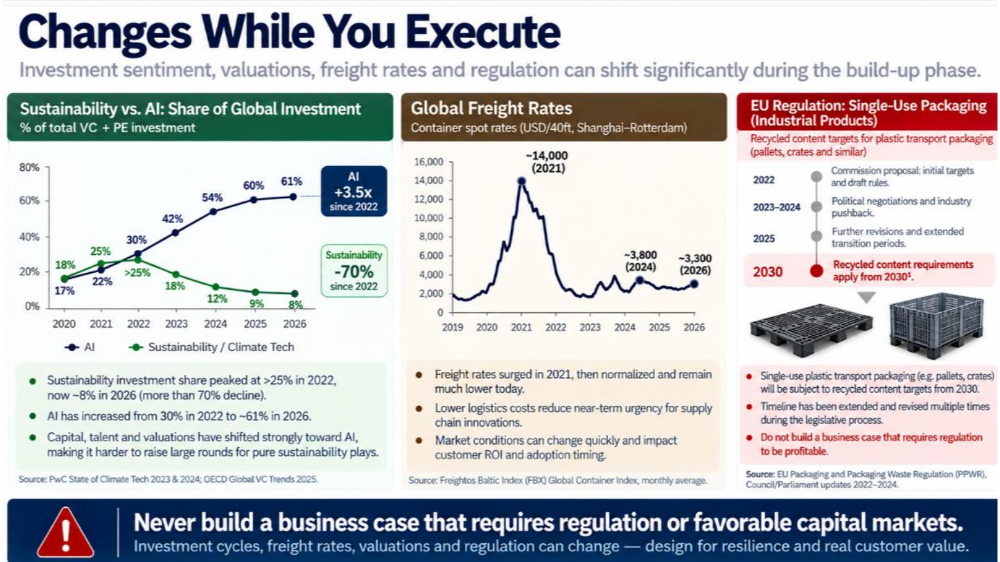

*Figure 14. Les panneaux portent sur les parts d'investissement, le taux spot de fret Shanghai–Rotterdam pour un conteneur de 40 pieds et le calendrier réglementaire. Ils expliquent comment les conditions du dossier économique évoluent pendant la construction de l'offre.*[^21]

- **Capital.** La courbe de la diapositive présente l'IA à 17 %, 22 %, 30 %, 42 %, 54 %, 60 % et 61 % de 2020 à 2026, et la durabilité ou *climate tech* à 18 %, 25 %, plus de 25 %, 18 %, 12 %, 9 % et 8 %. Le graphique les présente comme des parts de capital-risque et capital-investissement. Le badge « +3,5x depuis 2022 » ne concorde pas avec $61/30 \simeq 2{,}03$. Le rapport $61/17 \simeq 3{,}59$ correspond approximativement à un autre point de départ. Le visuel cite des rapports PwC et OCDE sans donner une méthode d'assemblage de séries. Utiliser les tendances comme scénarios, avec des périmètres à vérifier avant de citer les taux.[^21]
- **Fret.** Le visuel affiche environ 14 000 USD au pic 2021, 3 800 USD en 2024 et 3 300 USD en 2026. Le titre du panneau parle d'une route Shanghai–Rotterdam et le pied de figure renvoie au Freightos Baltic Index global. La provenance exacte de cette série doit être vérifiée pour un usage quantitatif. Le mécanisme utile est le suivant. Un fret aller moins cher peut réduire la valeur des gains de volume, tandis qu'un fret retour moins cher peut améliorer le modèle circulaire. Le signe de l'effet net dépend des deux flux.[^21]
- **Réglementation.** Le support montre une proposition en 2022, des négociations en 2023–2024, des révisions et transitions en 2025, puis un horizon 2030. Le visuel distinct du *Net-Zero Industry Act* montre un contexte de soutien à la fabrication de technologies propres. Ce texte ne se confond pas avec le règlement européen sur les emballages et déchets d'emballages, ou PPWR. Le support n'établit pas l'éligibilité de Ponera aux dispositifs présentés.[^18][^21][^22][^23]

**Complément sourcé.** Le règlement (UE) 2025/40 distingue contenu recyclé et réemploi. L'article 7 prévoit pour certaines catégories résiduelles d'emballages en plastique un minimum de 35 % de contenu recyclé post-consommation à compter du 1er janvier 2030 ou trois ans après l'entrée en vigueur de l'acte d'exécution visé, selon la date la plus tardive. La catégorie et les exceptions comptent. L'article 29 prévoit des objectifs de réemploi pour certaines formes d'emballages de transport et certaines circulations, avec des exceptions qui peuvent concerner notamment les emballages conçus sur mesure pour de grands équipements. Pour un cas client, vérifie la version applicable, le format, le flux et les exemptions avant d'inclure un effet dans le plan d'affaires.[^22]

**Complément pédagogique.** Pour rendre le modèle robuste, calcule trois dossiers cohérents. Un scénario central emploie les rotations et volumes du pilote. Un scénario de tension combine baisse de demande, collecte moins efficace et financement retardé. Un scénario favorable incorpore hausse des volumes, retour mieux organisé ou avantage réglementaire documenté. Les écarts doivent déclencher une décision définie à l'avance, par exemple différer une commande de moules, réduire le territoire ou proposer une location via un partenaire. Vérifie les interactions plutôt que de varier chaque paramètre séparément. Une vente retardée peut à la fois réduire les rotations et immobiliser plus longtemps le capital.

### Les neuf décisions à retenir du cas

1. Choisir un problème important ou trouver un usage pertinent pour une technologie.
2. Choisir les personnes selon leurs compétences, leurs objectifs, leurs valeurs et leurs rôles.
3. Vérifier tôt le besoin, le marché, la concurrence et la liberté d'exploitation.
4. Prototyper, tester et itérer assez tôt pour corriger les hypothèses.
5. Planifier l'industrialisation comme un projet distinct avec compétences, temps et capital dédiés.
6. Financer des jalons qui réduisent un risque identifiable. Prévoir la trésorerie jusqu'au prochain résultat.
7. Distinguer l'intérêt du client de la preuve d'adoption. Rendre l'essai et le changement de procédure accessibles.
8. Vérifier que le dossier économique résiste à une réglementation moins favorable ou à un accès au capital plus difficile.
9. Réexaminer les hypothèses et modifier la solution ou le modèle si les faits changent.[^21]

## Questions d'entraînement

| Question | Éléments de réponse |
|---|---|
| Pourquoi les retours et la rotation sont-ils plus importants qu'un prix catalogue pour évaluer le réemploi ? | La flotte porte un coût fixe et chaque rotation répartit ce coût sur un envoi de plus. Les retours, les pertes et les réparations augmentent le coût variable et peuvent ralentir les rotations. |
| Que prouve un test réussi sur une seule machine, chez un seul client ? | Il établit une preuve dans un périmètre précis. Les usages avec charges, engins, itinéraires ou conditions différents demandent de vérifier l'applicabilité des résultats. |
| Un client signe une LOI mais refuse d'engager un budget. Quel risque subsiste ? | L'intérêt est documenté. Le prix acceptable, l'autorisation, le financement et l'adoption dans l'exploitation demeurent à vérifier. |
| Comment expliquer la différence entre $20{,}187$ MPa et $236{,}607$ t dans le rapport Moldex3D ? | Le premier nombre est une pression à un emplacement. Le second est un effort de fermeture maximal lors du maintien, lié à la distribution de pression et à la surface projetée. |
| Que montrer au comité avant une commande de cinq moules ? | Demande démontrée et variantes, critères de qualification, dépendances fournisseur, coûts et cadence de chaque référence, cash disponible, écart tolérable et possibilité de commander par étapes. |
| Pourquoi un marché de 600 millions ne donne-t-il pas un chiffre d'affaires prévisionnel ? | Il faut confirmer devise, segment et méthode, puis estimer la fraction captable avec les contraintes de vente, de capacité et de déploiement. |
| Le support annonce 73 % d'économies. Que vérifier avant d'appliquer ce résultat ailleurs ? | La référence de coûts, les volumes, le trajet, le retour, le nombre de cycles, les coûts de remplacement et le périmètre des flux. Le modèle est propre au cas CH–RO. |

## Couverture du support

Les pages sont numérotées selon l'ordre du PDF. Les pages de transition sont indiquées pour retrouver la progression du support.

| Pages | Contenu contrôlé | Section |
|---|---|---|
| 1–2 | Titre, intervenant et contexte professionnel | Introduction |
| 3–5 | Exemples d'emballages et ordres de grandeur revendiqués | § 1 |
| 6–9 | Mission, matériel modulaire, impacts et coûts | § 1 |
| 10–12 | IoT, modèle économique, essais, clients et charges | § 1, § 6 |
| 13–14 | Point de départ de l'innovation et deux trajectoires | § 2 |
| 15–16 | Comparaison des processus Bühler actuel et visé | § 1 |
| 17–19 | Constats logistiques, Internet physique et comparaison des réseaux | § 1 |
| 20–21 | Modularité, réseau d'acteurs et plateforme | § 1 |
| 22–24 | Transition vers la validation, causes d'échec et recherche des goulots | § 2 |
| 25–26 | Carte concurrentielle, SAM et présentation au marché dès 2019 | § 2 |
| 27–30 | Développement, MVP, premiers prototypes, transition financière et équipe | § 3 |
| 31–33 | Pitch, jalons, financement, estimation du marché et extension numérique | § 2, § 3 |
| 34–36 | Simulation, moules et démarrage industriel | § 4 |
| 37–40 | Itérations, essais opérationnels, décision go/no-go et POC clients | § 4 |
| 41–43 | Liaison, requalification et charges supérieures à 15 t | § 4 |
| 44–46 | Réduction des barrières à l'adoption, cycle de vente et identification du client | § 5 |
| 47–49 | Cas CH–RO, FR–FR et aide à l'intégration opérationnelle | § 5 |
| 50–53 | Intelligence de marché, risque linéaire et circulaire, offre et cas tarifaires | § 6 |
| 54 | Contexte du Net-Zero Industry Act | § 7 |
| 55–56 | Financement de la solution complète et chaîne d'approvisionnement | § 3, § 4 |
| 57–60 | Conception de la caisse, prototypes, pilotes et données techniques | § 4 |
| 61 | Équipement connecté, logiciel, données et flotte | § 6 |
| 62–64 | Gouvernance, évolutions externes et neuf enseignements | § 7 |

## Références

[^1]: Matthew Reali, *Project Management in Innovation and Entrepreneurship with Ponera case study*, EPFL MGT-427, date imprimée du 6 octobre 2026. [PDF du cours](../slides/3_MGT_427_guest_lecture_PMRA.pdf), pp. 1–2 et 64.
[^2]: Reali, [PDF du cours](../slides/3_MGT_427_guest_lecture_PMRA.pdf#page=15), pp. 3 et 15–16. Processus d'emballage et variante Bühler.
[^3]: Reali, [PDF du cours](../slides/3_MGT_427_guest_lecture_PMRA.pdf#page=17), pp. 17–21. Constat logistique, Internet physique et réseau.
[^4]: Reali, [PDF du cours](../slides/3_MGT_427_guest_lecture_PMRA.pdf#page=4), pp. 4–12. Chiffres et fonctions déclarés par Ponera.
[^5]: Fondation Solar Impulse, [IoT enabled Modular pallets](https://impulse-foundation.com/solutions/solutions-explorer/portfolio/solutions/iot-enabled-modular-pallets). Fiche du label et bénéfices annoncés pour des flux adaptés.
[^6]: Eurostat, [Key figures on European transport, édition 2024](https://ec.europa.eu/eurostat/documents/15216629/20875401/KS-01-24-021-EN-N.pdf/57b33b96-c376-0e03-f7e1-11ac0f902eba?t=1745499042032&version=6.0), p. 26. Véhicules-kilomètres à vide en 2023.
[^7]: S. Jaleel Shaikh, B. Montreuil, M. Hodjat-Shamami et A. Gupta, [Introducing Services and Protocols for Inter-Hub Transportation in the Physical Internet](https://arxiv.org/abs/2111.07520), 2021. Proposition de recherche sur les services et protocoles de relais.
[^8]: Reali, [PDF du cours](../slides/3_MGT_427_guest_lecture_PMRA.pdf#page=13), pp. 13–14 et 22–26. Points de départ, validation, estimations, concurrence et contact marché.
[^9]: OMPI, [Launching a New Product: Freedom to Operate](https://www.wipo.int/en/web/wipo-magazine/articles/ip-and-business-launching-a-new-product-freedom-to-operate-34956), 2005. Voir aussi le [guide de recherche FTO de l'OMPI](https://www.wipo.int/publications/en/details.jsp?id=4501).
[^10]: Reali, [PDF du cours](../slides/3_MGT_427_guest_lecture_PMRA.pdf#page=27), pp. 27–30. MVP, prototypes et composition de l'équipe.
[^11]: Reali, [PDF du cours](../slides/3_MGT_427_guest_lecture_PMRA.pdf#page=31), pp. 31–32 et 55. Périmètre initial, pitch et phases de financement.
[^12]: Reali, [PDF du cours](../slides/3_MGT_427_guest_lecture_PMRA.pdf#page=33), p. 33. Deuxième visuel d'estimation de marché et applications numériques.
[^13]: Reali, [PDF du cours](../slides/3_MGT_427_guest_lecture_PMRA.pdf#page=34), p. 34. Rapport de simulation Moldex3D.
[^14]: Reali, [PDF du cours](../slides/3_MGT_427_guest_lecture_PMRA.pdf#page=35), pp. 35–43. Outillage, exploitation initiale, tests, itérations et requalification.
[^15]: Moldex3D, [Principles of Computer-aided Engineering of Thermoplastic Injection Molding: Process Settings](https://www.moldex3d.com/blog/top-story/principles-of-computer-aided-engineering-of-thermoplastic-injection-molding-process-settings/). Explications du fabricant sur les réglages de moulage.
[^16]: Reali, [PDF du cours](../slides/3_MGT_427_guest_lecture_PMRA.pdf#page=44), pp. 44–46. Adoption B2B, cycle de vente et parties prenantes.
[^17]: Reali, [PDF du cours](../slides/3_MGT_427_guest_lecture_PMRA.pdf#page=47), pp. 47–49. Dossiers économiques et appui opérationnel.
[^18]: Reali, [PDF du cours](../slides/3_MGT_427_guest_lecture_PMRA.pdf#page=50), pp. 50–54. Intelligence de marché, profils de risque, options commerciales, prix illustratifs et contexte réglementaire.
[^19]: Reali, [PDF du cours](../slides/3_MGT_427_guest_lecture_PMRA.pdf#page=56), p. 56. Chaîne industrielle, capacité et entrepôts.
[^20]: Reali, [PDF du cours](../slides/3_MGT_427_guest_lecture_PMRA.pdf#page=57), pp. 57–61. Caisse modulaire, itérations, caractéristiques et architecture numérique.
[^21]: Reali, [PDF du cours](../slides/3_MGT_427_guest_lecture_PMRA.pdf#page=62), pp. 62–64. Gouvernance, tendances et leçons finales.
[^22]: Union européenne, [Règlement (UE) 2025/40 relatif aux emballages et aux déchets d'emballages](https://eur-lex.europa.eu/legal-content/FR/TXT/?uri=CELEX%3A32025R0040), articles 7 et 29. Conditions, échéances et exceptions du texte.
[^23]: Commission européenne, [The Net-Zero Industry Act](https://single-market-economy.ec.europa.eu/industry/sustainability/net-zero-industry-act_en). Présentation du périmètre du règlement sur l'industrie « zéro net ».
