# Évaluation économique d'un projet

Cette fiche développe le [support de Philippe Wieser](../slides/4_MGT_427_eco_26.pdf) sur le choix d'investissement en horizon incertain. Les notes numérotées indiquent les pages du PDF. Les passages « Contenu du cours » et les légendes décrivent le support. Les compléments et exemples construits sont signalés séparément. Le support porte le millésime 2024 dans son pied de page, malgré le suffixe « 26 » du fichier.[^1]

## 1. Comparer les variantes avant d'engager les coûts

**Contenu du cours.** Pendant l'étude, l'équipe a encore une grande marge de manœuvre et a engagé peu de coûts. Les dépenses cumulées augmentent pendant la réalisation, alors que les possibilités de changer de solution diminuent. L'évaluation économique intervient tôt, avec les approches technique, organisationnelle, de planification, environnementale et sociale. Les critères nourrissent une analyse multicritère. La distribution du risque au-dessus du cycle suggère que le résultat dépend d'hypothèses incertaines. Les marques « min », « p.p. », « MAX » et $\sigma$ évoquent un domaine de variation, la valeur la plus probable et une dispersion. Le dessin ne prescrit aucune loi de probabilité.[^2]

**Lecture pédagogique.** Une variante peut coûter moins cher à construire et davantage à exploiter. Une autre peut produire une valeur économique élevée tout en enfreignant une contrainte de sécurité ou en exigeant un financement inaccessible. Définissez d'abord le service attendu, puis comparez les conséquences sur un périmètre commun. La [fiche d'introduction](01-introduction-au-management-de-projet.md) replace la décision dans le cycle du projet. La [fiche sur les risques](02-analyse-des-risques.md) montre comment l'équipe identifie et traite les événements susceptibles de modifier les flux.

### L'échéancier des recettes, dépenses et investissements

**Contenu du cours.** Sur l'échéancier, les recettes $R_t$ sont au-dessus de l'axe du temps. Les investissements $I_t$ et les dépenses $D_t$ sont sous l'axe. Le dessin montre deux décaissements d'investissement, puis plusieurs périodes où recettes et dépenses coexistent. Un flux peut être une donnée directe ou le résultat d'un calcul à partir de données primaires. Le support donne l'exemple du nombre de pièces multiplié par le prix de vente unitaire.[^3]

| Symbole | Grandeur à la date $t$ | Exemple |
|---|---|---|
| $R_t$ | Recettes encaissées ou économies traitées comme un gain. | $R_t=q_t p_t$ si $q_t$ pièces sont vendues et encaissées au prix $p_t$. |
| $I_t$ | Décaissements d'investissement, exprimés en montants positifs avant soustraction. | Acquisition, construction ou remplacement d'un équipement. |
| $D_t$ | Dépenses d'exploitation ou autres sorties du périmètre, exprimées avant soustraction. | Énergie, personnel, entretien, coût de fabrication $q_t c_t$. |
| $\mathrm{VRI}_T$ | Valeur résiduelle des investissements à la date de fin $T$. | Produit de revente net des frais ou valeur restante justifiée par l'usage au-delà de l'horizon. |
| $CF_t$ | Flux net ordinaire de la période. | $R_t-I_t-D_t$, en traitant la valeur résiduelle séparément. |

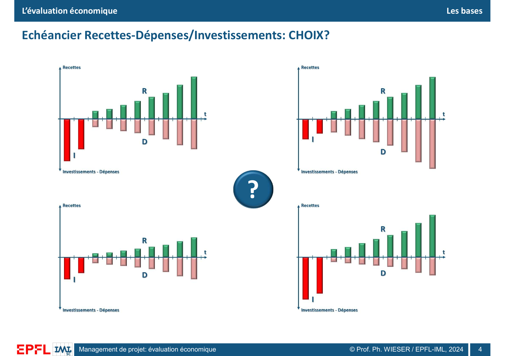

*Support, p. 4.* Les deux variantes du haut dessinent des recettes similaires, avec des investissements et dépenses différents. En bas, la variante de gauche combine un investissement plus faible et des recettes plus modestes. Celle de droite demande des investissements plus élevés et dessine des recettes croissantes face à des dépenses d'exploitation plus faibles. Les barres posent la question du choix. L'absence d'échelle chiffrée et de taux empêche de déduire un classement précis.[^3]

**Complément pédagogique.** Fixez le point de vue (exploitant, promoteur, collectivité), la référence (par exemple maintenir l'existant), la monnaie et l'année de valeur, l'horizon et les dates des flux. Si un équipement économise 30 kCHF par an et coûte 8 kCHF de maintenance supplémentaire, son gain annuel différentiel est 22 kCHF. Une étude payée dans le passé et irrécupérable figure dans le bilan des dépenses passées. Une décision prospective compare les conséquences encore modifiables.[^11][^12]

Placez les flux aux dates de paiement. Une facture peut précéder l'encaissement. Le coût d'achat d'une machine figure à sa date de paiement. L'amortissement comptable étale ce coût dans les comptes. Son incidence éventuelle sur les flux relève, par exemple, du calcul des impôts dans une analyse après impôt.[^11]

## 2. Actualiser les flux et lire les critères

### Valeur actuelle nette

**Contenu du cours.** La valeur actuelle nette (VAN) soustrait les investissements et dépenses actualisés des recettes actualisées. Elle ajoute la valeur résiduelle actualisée, notée $\mathrm{VRI}_a$. Si la valeur résiduelle tombe à la dernière date $T$, on écrit la formule suivante.[^4]

$$
\begin{aligned}
\mathrm{VAN}(i)
&= \sum_{t=0}^{T}\frac{R_t}{(1+i)^t}
-\left[\sum_{t=0}^{T}\frac{I_t}{(1+i)^t}
+\sum_{t=0}^{T}\frac{D_t}{(1+i)^t}\right]
+\mathrm{VRI}_a,\\
\mathrm{VRI}_a&=\frac{\mathrm{VRI}_T}{(1+i)^T}.
\end{aligned}
$$

**Dérivation.** Une somme $P$ placée aujourd'hui au taux composé $i$ vaut $P(1+i)^t$ à la date $t$. La somme aujourd'hui équivalente à $F_t$ en $t$ est donc $F_t/(1+i)^t$. À 10 % par an, 121 CHF dans deux ans valent 100 CHF aujourd'hui. Les flux à $t=0$ gardent leur valeur. À $i=0$, la VAN devient la somme algébrique des flux, valeur résiduelle comprise. Le taux et les durées utilisent la même période. Avec des flux annuels en fin d'année et un taux annuel effectif, le premier exposant positif est 1.[^4][^11]

Si $R_T$ contient déjà le prix de revente net, posez $\mathrm{VRI}_T=0$ dans le terme séparé. Une obligation de démantèlement est une sortie à sa date, qu'on peut inscrire en $D_T$ ou dans une valeur terminale nette. La valeur résiduelle aide à comparer des durées de vie différentes sur un horizon commun. Elle dépend, par exemple, de la durée d'usage restante et de la valeur de marché. La pente schématique de la p. 5 relie les investissements à la valeur résiduelle et ne fixe aucune règle d'amortissement.[^4][^11]

**Complément pédagogique sourcé.** Le taux d'actualisation traduit une valeur du temps et un coût d'opportunité ou rendement exigé adaptés au point de vue de l'analyse. Un modèle en prix constants utilise un taux réel. Un modèle en prix courants inclut l'évolution prévue des prix et utilise un taux nominal cohérent. Pour une inflation uniforme $\pi$, la relation est $1+i_{\text{nominal}}=(1+i_{\text{réel}})(1+\pi)$. Il reste à estimer les hausses propres à certaines ressources si elles s'écartent de l'inflation générale.[^11][^12]

Une VAN positive signifie que les gains actualisés excèdent les coûts actualisés au taux retenu. Une VAN nulle signifie que le projet atteint exactement le rendement incorporé dans le taux, pour les flux retenus. Un gain nominal positif peut donner une VAN négative si les recettes arrivent tard. Pour comparer des variantes mutuellement exclusives aux effets comparables, calculez leurs VAN au même taux et à la même date, puis $\Delta\mathrm{VAN}=\mathrm{VAN}_B-\mathrm{VAN}_A$. Une variante isolée peut aussi être comparée à l'option sans projet ou au rendement exigé. La p. 7 insiste sur l'usage comparatif.[^4][^5][^11][^12]

### Taux interne de rentabilité et durée de récupération

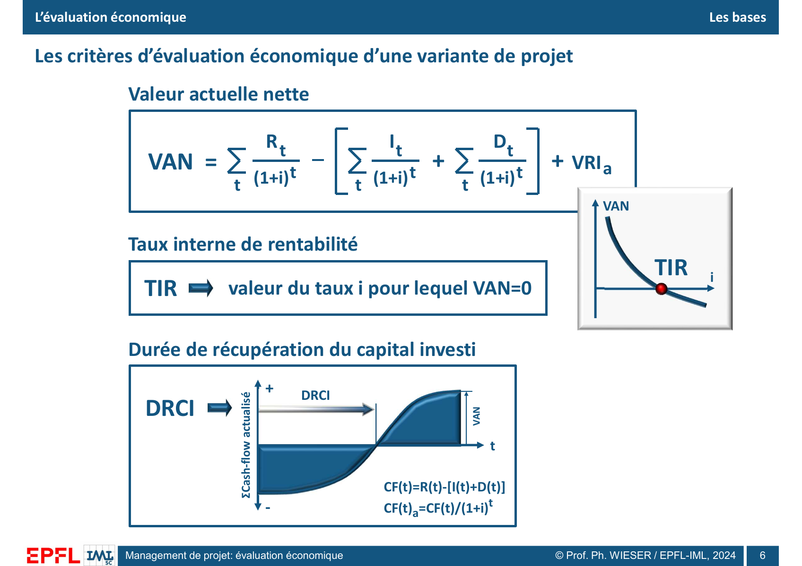

*Support, p. 6.* En haut à droite, l'abscisse est le taux $i$. Le point rouge est le taux interne de rentabilité (TIR). En bas, l'abscisse est le temps. La durée de récupération du capital investi (DRCI) se lit au passage du cumul actualisé de négatif à positif. La hauteur finale est la VAN à la date de référence, pour le taux choisi et les flux représentés.[^4]

**TIR.** Le TIR est une racine de $\mathrm{VAN}(i)=0$. Avec un investissement initial et des flux ultérieurs tous positifs ou nuls dont au moins un est strictement positif, la VAN décroît strictement pour $i>-1$. En notant $\widetilde{CF}_t$ le flux qui inclut la valeur résiduelle à sa date, la dérivée le montre directement.[^4][^11]

$$
\frac{\mathrm{d}\mathrm{VAN}}{\mathrm{d}i}=
-\sum_{t=1}^{T}\frac{t\,\widetilde{CF}_t}{(1+i)^{t+1}}.
$$

Dans ce cas, un taux exigé inférieur au TIR donne une VAN positive. Numériquement, encadrez une racine par deux taux donnant des VAN de signes opposés, puis divisez l'intervalle par deux jusqu'à la précision voulue. Plusieurs changements de signe dans les flux peuvent donner plusieurs TIR. Par exemple, pour $(-100,230,-132)$, multiplier l'équation de VAN nulle par $(1+i)^2$ donne $-100(1+i)^2+230(1+i)-132=0$. Les deux racines sont 10 % et 20 %. Un gros décaissement de remise en état peut créer ce profil. Avec des flux tous strictement positifs, la VAN n'a aucune racine pour $i>-1$.[^11]

**DRCI.** Le cours emploie le délai de récupération *actualisé*. Il note $CF(t)=R(t)-[I(t)+D(t)]$ et $CF(t)_a=CF(t)/(1+i)^t$. Calculez le cumul $C_k=\sum_{t=0}^{k}\widetilde{CF}_t/(1+i)^t$, en incluant l'éventuelle valeur résiduelle à sa date. La première date où $C_k\ge 0$ donne le délai en périodes discrètes. Si $C_{k-1}<0$ et $C_k>0$, on peut interpoler en supposant que le cumul évolue linéairement dans la période. Avec un encaissement strictement en fin de période, la récupération est à la date $k$.[^4]

$$
\mathrm{DRCI}_{\text{interpolée}}=(k-1)+\frac{-C_{k-1}}{C_k-C_{k-1}}.
$$

Si le cumul reste négatif, le capital n'est pas récupéré sur l'horizon. Si un décaissement tardif rend le cumul à nouveau négatif, signalez ce deuxième franchissement. La DRCI renseigne sur la vitesse de récupération. La VAN intègre tous les flux jusqu'à la fin. Le délai *simple* de récupération applique le même principe aux flux non actualisés.[^4]

### ROI et périmètre du financement

**Contenu du cours.** La p. 7 donne $\mathrm{ROI}=\mathrm{Gain}/\mathrm{Investissement}$ et le présente comme un autre indicateur, plus orienté finance. Elle qualifie VAN, TIR et DRCI de critères intrinsèques au projet. Dans le modèle du support, les flux $I$, $R$ et $D$ sont établis sans détailler les moyens et la forme du financement.[^5]

| Indicateur | Unité | Lecture | Point de vigilance |
|---|---|---|---|
| VAN | Monnaie à la date de référence. | Gain net actualisé au taux retenu. | Dépend du périmètre, de l'horizon et du taux. |
| TIR | Pourcentage par période. | Taux qui annule la VAN. | La taille et le calendrier des projets peuvent inverser le classement par rapport à la VAN. |
| DRCI | Temps. | Date de récupération du capital en flux actualisés selon le cours. | Les flux après le premier franchissement ne comptent pas dans ce délai. |
| ROI | Ratio ou pourcentage. | Gain rapporté à l'investissement. | Définir le gain net ou brut, la période et le dénominateur. Le ratio du support n'intègre pas explicitement l'actualisation. |

**Complément pédagogique sourcé.** La VAN et le TIR s'appliquent aussi en analyse financière lorsqu'on utilise les flux financiers pertinents. Une analyse socioéconomique peut inclure les coûts et bénéfices pour la collectivité, par exemple du temps gagné ou des nuisances, s'ils sont valorisés et attribuables. Le modèle simplifié du cours étudie les flux du projet indépendamment du montage financier. Pour examiner la capacité de paiement ou le rendement des fonds propres, il faut un échéancier adapté qui traite les apports, tirages, intérêts et remboursements au bon endroit. Une VAN positive peut coexister avec un déficit de trésorerie initial.[^5][^11][^12]

## 3. Exemple calculé de comparaison

**Exemple construit pour la fiche.** Deux équipements alternatifs rendent un service comparable pendant trois ans. Les chiffres sont en kCHF. Il n'y a qu'un investissement, à $t=0$. Chaque variante a 25 kCHF de dépenses par année d'exploitation et une valeur résiduelle nette de 10 kCHF à $t=3$. Les recettes annuelles de A sont 70, 70 et 70. Celles de B sont 95, 90 et 90. Le taux d'actualisation est 10 % et les flux annuels arrivent en fin d'année.

| Année $t$ | Facteur $1/(1+i)^t$ | Flux A, valeur résiduelle incluse en 3 | Flux A actualisé | Cumul A | Flux B, valeur résiduelle incluse en 3 | Flux B actualisé | Cumul B |
|---:|---:|---:|---:|---:|---:|---:|---:|
| 0 | 1,0000 | −100 | −100,00 | −100,00 | −150 | −150,00 | −150,00 |
| 1 | 0,9091 | 45 | 40,91 | −59,09 | 70 | 63,64 | −86,36 |
| 2 | 0,8264 | 45 | 37,19 | −21,90 | 65 | 53,72 | −32,64 |
| 3 | 0,7513 | 55 | 41,32 | 19,42 | 75 | 56,35 | 23,70 |

Pour A, $\mathrm{VAN}=-100+45/1{,}10+45/1{,}10^2+55/1{,}10^3=19{,}42$ kCHF. Pour B, la VAN vaut 23,70 kCHF. Le supplément d'investissement de B coûte 50 kCHF au départ et apporte 25, 20 et 20 kCHF de plus. Leur VAN différentielle est 4,28 kCHF à 10 %. Le taux d'égalité résout $-50+25/(1+i)+20/(1+i)^2+20/(1+i)^3=0$, soit environ 15,02 %. Au-delà, A dépasse B sur le critère VAN.

| Variante | VAN à 10 % | TIR | DRCI interpolée | ROI cumulé simple |
|---|---:|---:|---:|---:|
| A | 19,42 kCHF | 20,36 % | 2,53 ans | $45/100=45\,\%$ |
| B | 23,70 kCHF | 18,68 % | 2,58 ans | $60/150=40\,\%$ |

Pour A, la DRCI interpolée vaut $2+21{,}90/41{,}32\approx2{,}53$ ans. Avec les paiements de fin d'année posés dans l'exemple, les deux variantes atteignent le seuil à la date 3. L'interpolation illustre la méthode et répartit notamment sur l'année une cession supposée en fin de période. Le ROI retient le gain total net non actualisé, cession comprise. À 10 %, B crée davantage de valeur. A affiche un TIR et un ROI supérieurs, ainsi qu'un investissement initial plus faible.[^4][^5][^11]

## 4. Du scénario de référence au risque économique

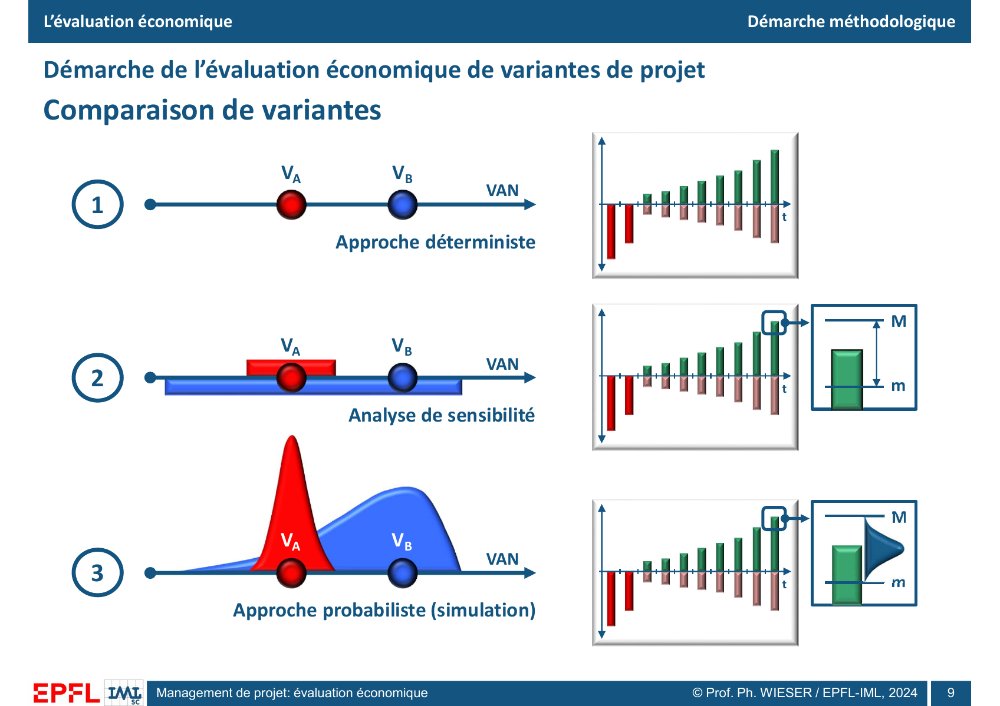

*Support, p. 9.* Avec une valeur par flux, B donne une VAN supérieure à A. En sensibilité, les entrées varient entre des bornes $m$ et $M$. La plage de B est plus large et s'étend sous une partie des résultats de A. Les densités de la dernière ligne montrent une distribution rouge resserrée et une distribution bleue plus étalée vers les valeurs basses. Ces tracés ne fournissent aucune probabilité chiffrée.[^6]

| Approche | Entrées | Sortie | Question |
|---|---|---|---|
| Déterministe | Une valeur par flux ou donnée primaire. | Une VAN par variante au taux retenu. | Quel résultat donnent les hypothèses de référence ? |
| Sensibilité | Bornes, écarts, scénarios ou variation du taux. | Écarts, classement des facteurs, plages et seuils. | Quelle hypothèse pourrait changer la conclusion ? |
| Probabiliste | Distributions et dépendances explicites. | Distribution des VAN et probabilités conditionnelles au modèle. | Avec quelle probabilité le résultat manque-t-il un seuil ? |

### Sensibilité locale, scénarios et valeurs de bascule

**Contenu du cours.** Les p. 10 et 11 font varier des entrées et classent les données influentes. On peut tracer une bande de VAN pour plusieurs taux $i$, ou examiner les données influentes pour décider de leur attribuer une loi. Le classement dessiné, $D_1$, $R_4$, $D_8$, $I_3$, $R_1$, représente des éléments datés de l'échéancier. Cet ordre illustre le principe, sans hiérarchie générale entre familles de flux.[^7]

**Complément pédagogique sourcé.** Fixez une base, faites varier une entrée à la fois sur une plage motivée, puis recalculez. Pour comparer des entrées d'unités différentes, comparez leurs effets sur des plages plausibles propres à chaque entrée, ou testez le même pourcentage si cette convention répond à la question. Le classement change selon les amplitudes choisies. Lorsqu'on fait varier plusieurs entrées, leur combinaison doit correspondre à un scénario possible. Des extrêmes combinés sans vérifier les dépendances peuvent former un scénario incohérent.[^12][^13]

À taux fixe, une variation $\Delta R_t$ d'une recette indépendante change la VAN de $\Delta R_t/(1+i)^t$. Une hausse de dépense la réduit du même montant actualisé. Une entrée primaire peut affecter plusieurs flux. Avec une recette $q_t p_t$ et une dépense variable $q_t c_t$, l'effet d'une unité vendue en plus est $(p_t-c_t)/(1+i)^t$ si les prix et coûts unitaires sont constants.

**Exemple construit pour la fiche.** Multiplions les recettes annuelles de A par un facteur commun $q$, en gardant les dépenses fixes. La valeur actuelle des recettes de référence est $70(1/1{,}10+1/1{,}10^2+1/1{,}10^3)=174{,}08$ kCHF. Par conséquent, $\mathrm{VAN}_A(q)=19{,}42+174{,}08(q-1)$ kCHF, aux arrondis près. À −10 % de recettes, la VAN vaut 2,01 kCHF. À +10 %, elle vaut 36,83 kCHF. La valeur de bascule est $q\approx0{,}8884$. Une baisse de recettes d'environ 11,16 % annule la VAN. Ce seuil mesure la marge de sécurité sous ces hypothèses. Il ne donne aucune probabilité de baisse.[^12]

Testez aussi les dates. Si A encaisse 45 kCHF nets en année 1, puis décale les 45 et 55 kCHF suivants aux années 3 et 4 sans flux en année 2, sa VAN tombe de 19,42 à 12,28 kCHF. L'horizon est prolongé et les flux terminaux décalés, sans coût d'attente supplémentaire. Avec une date de clôture fixe, il faut décider si le flux reporté sort de l'horizon ou entre dans la valeur terminale. Un retard réel peut aussi entraîner des dépenses supplémentaires.

Le seuil sert ensuite à choisir une action. Si la fréquentation réelle se rapproche du seuil de bascule, l'équipe peut mesurer la demande avant un engagement irréversible, négocier un investissement par étapes ou revoir le service. La donnée la plus influente n'est pas forcément celle qu'il est possible de maîtriser. Une analyse de sensibilité permet de distinguer une donnée à mieux estimer, comme la demande, d'une décision à tester, comme le tarif ou le phasage. Les plages testées restent des hypothèses de décision. Même un scénario dit pessimiste peut omettre des événements plus graves.[^12][^13]

### Simulation probabiliste et dépendances

**Contenu du cours.** La démarche part de l'échéancier et des données de base. Elle distingue les entrées déterministes des entrées probabilistes, mobilise une bibliothèque de fonctions standards ou libres et examine les couplages. Les flèches horizontale et verticale de la p. 12 évoquent des dépendances dans le temps et entre variables. La simulation fait passer des distributions d'entrées à une distribution de VAN.[^8]

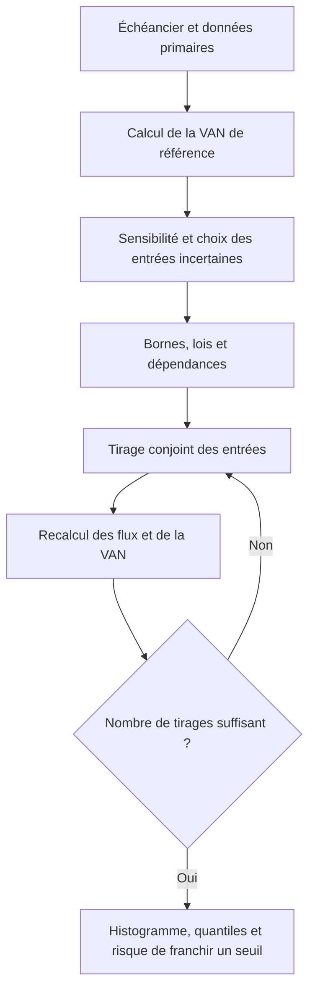

**Complément pédagogique sourcé.** Une loi uniforme entre $m$ et $M$ a une densité constante dans cette plage. Une loi triangulaire utilise un minimum, un maximum et un mode compris entre les bornes. Une loi discrète peut représenter des scénarios exclusifs et leurs probabilités. Choisissez une loi dont le domaine et la forme correspondent au mécanisme et aux données. Une loi normale non tronquée peut produire des valeurs négatives et ne convient donc pas automatiquement à un coût strictement positif. « Optimiste » et « pessimiste » désignent l'effet économique. Pour une dépense, le montant optimiste est souvent le plus faible. Pour une recette, il est souvent le plus élevé. Trois valeurs plausibles n'identifient pas une loi unique. Le mode peut différer de la moyenne et de la médiane.[^13][^14]

Deux variables reliées physiquement doivent être calculées ensemble. Le même volume simulé $q_t$ alimente les ventes $q_t p_t$ et les coûts variables $q_t c_t$. Une variation de demande persistante peut toucher plusieurs années. Deux variantes au même emplacement peuvent partager le même choc. Les tirer indépendamment change la dispersion de la VAN ou la probabilité que B dépasse A. Utilisez un facteur commun ou une loi jointe documentée. L'espérance de $q_t p_t$ peut différer de $\mathrm{E}[q_t]\mathrm{E}[p_t]$ si les entrées sont corrélées. À taux fixe, l'espérance de la VAN est toutefois la VAN des flux nets moyens, par linéarité.[^13]

Pour calibrer une loi, documentez l'origine de chaque paramètre. Une série historique comparable peut fournir des quantiles. Des devis peuvent encadrer un prix. Un avis d'expert peut donner une plage conditionnelle à un calendrier ou à une technologie. Distinguez une borne physique d'un percentile estimé. Par exemple, 500 places est une capacité maximale, tandis qu'une hypothèse selon laquelle 90 % des jours ont moins de 450 places occupées est une affirmation statistique à étayer. Si les sources ne permettent que deux scénarios crédibles sans poids, la sensibilité reste interprétable. Une simulation avec des probabilités arbitraires ajouterait une précision apparente.[^8][^13]

### Tirer une variable et lire la distribution des VAN

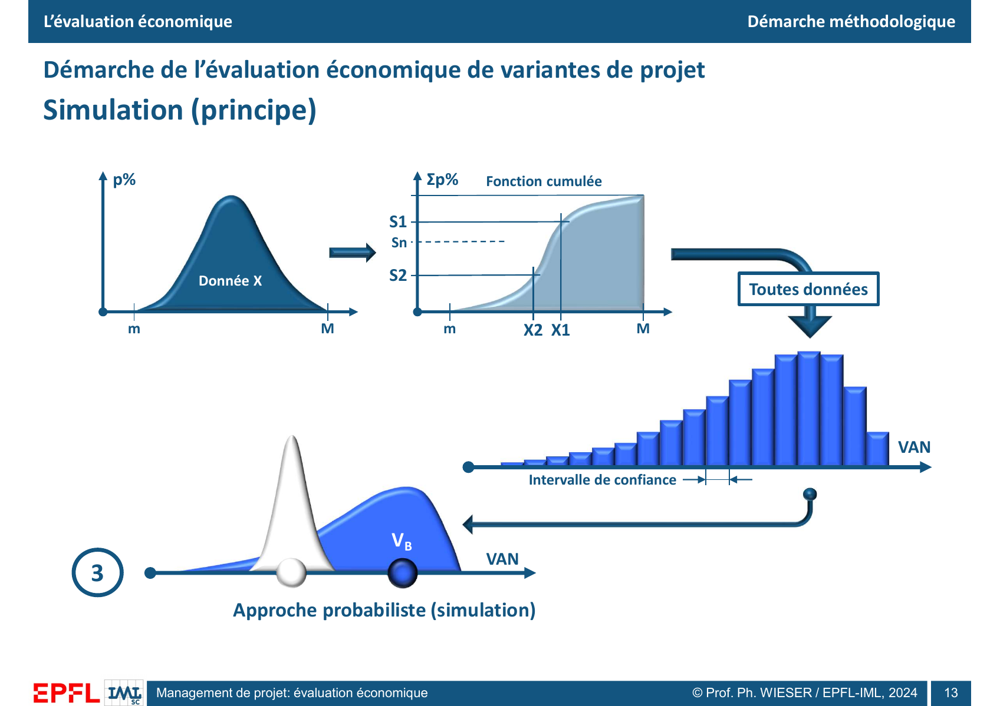

*Support, p. 13.* À gauche, la forme représente la répartition des valeurs possibles de l'entrée $X$ entre $m$ et $M$. Au milieu, la fonction cumulée croît vers 100 %. Les niveaux $S_1$, $S_2$, … se lisent en ordonnée et donnent les valeurs $X_1$, $X_2$, … en abscisse. Après tirage de toutes les données, l'équipe calcule une VAN par réalisation, puis regroupe les résultats dans un histogramme. Pour une variable continue, une probabilité se lit sur une aire entre deux valeurs de $X$, plutôt que sur la hauteur de densité à un point.[^8][^14]

**Dérivation du tirage inverse.** La fonction cumulée est $F_X(x)=\Pr(X\le x)$. Tirez $U$ uniformément entre 0 et 1 et posez $X=F_X^{-1}(U)$, avec le quantile généralisé si la loi comporte des sauts. Alors $\Pr(F_X^{-1}(U)\le x)=\Pr(U\le F_X(x))=F_X(x)$. Pour $X$ uniforme entre 80 et 120, $F_X^{-1}(u)=80+40u$. Le tirage $u=0{,}25$ produit $X=90$. Le même percentile donnerait une autre valeur sous une loi triangulaire. L'inversion reproduit la loi marginale d'une entrée. Le tirage conjoint doit aussi reproduire les dépendances modélisées.[^14]

Après $N$ simulations, notez $V_s$ la VAN du scénario $s$. Divisez le nombre de $V_s<0$ par $N$ pour estimer la probabilité de VAN négative. Pour lire le quantile défavorable à 5 %, ordonnez les VAN et repérez le premier niveau où le cumul atteint 5 % selon la convention retenue. Pour comparer deux variantes sur des scénarios communs, calculez aussi la distribution de $V_{B,s}-V_{A,s}$. Le chevauchement des histogrammes marginaux ne suffit pas pour obtenir cette distribution.

La p. 13 porte la mention « intervalle de confiance » sous l'histogramme, sans préciser l'estimateur, la méthode ou le niveau. L'intervalle de quantiles $[Q_{0{,}05},Q_{0{,}95}]$ encadre environ 90 % des résultats d'un modèle continu. Un intervalle de confiance pour la moyenne estimée quantifie l'erreur d'estimation liée à un nombre fini de tirages. Si les tirages sont indépendants et assez nombreux, une approximation à 95 % est $\bar V\pm1{,}96s/\sqrt{N}$, avec $\bar V$ la moyenne et $s$ l'écart type empirique. Augmenter $N$ resserre cette erreur d'estimation sans modifier l'incertitude économique. Vérifiez aussi la stabilité des quantiles et de la fréquence de perte. Les queues sont souvent plus difficiles à estimer que la moyenne.[^8][^13][^14]

**Exemple construit pour la fiche.** Appliquons le même facteur de demande $q$ aux recettes de A et B. Les dépenses et valeurs résiduelles restent fixes. Les probabilités sont fictives. Les trois lignes constituent une distribution discrète exacte sous ces hypothèses. Une simulation répétant ces trois états approximerait ces mêmes résultats.

| Demande $q$ | Probabilité | VAN A, kCHF | VAN B, kCHF | Écart B moins A, kCHF |
|---:|---:|---:|---:|---:|
| 0,75 | 20 % | −24,10 | −33,39 | −9,29 |
| 1,00 | 60 % | 19,42 | 23,70 | 4,28 |
| 1,15 | 20 % | 45,53 | 57,96 | 12,42 |

Chaque variante a 20 % de probabilité de VAN négative. La moyenne vaut 15,94 kCHF pour A et 19,14 kCHF pour B. B dépasse A dans 80 % des cas et subit une perte plus forte dans le scénario défavorable. Une organisation qui ne peut pas absorber 33,39 kCHF de perte doit examiner sa tolérance au risque et les mesures possibles avant de retenir B. La moyenne et la probabilité de perte se lisent donc avec la taille des pertes.

## 5. MODEC relie les hypothèses aux résultats

**Contenu du cours.** MODEC, « MODule EConomique » dans le titre de la fenêtre, illustre les trois niveaux d'analyse. Les p. 14 à 20 sont des captures d'écran. L'arbre de gauche sépare la variante, les données, les analyses déterministe, de sensibilité et probabiliste. Les sorties comprennent les flux annuels et cumulés, la VAN et ses indicateurs, des graphes de VAN et de VRI, le TIR et la comparaison entre variantes. Le formulaire de la « Nouvelle usine mécanique » de la p. 14 affiche 1998–2007, une actualisation à 1998 et une unité « KFS » explicitée en kilo francs suisses. Ce sont les paramètres de cette capture. D'autres écrans du même ensemble ont des paramètres différents.[^9]

### Saisir les données et leurs relations

La p. 15 illustre deux formes de saisie. Les investissements portent une année, une durée et trois valeurs. Les dépenses sont présentées par année. La première table comporte une ligne calculée « Calcul.Vente immeubles » (2004, durée 4, valeurs 2 000, 1 600 et 2 200), avec une case de visualisation des calculs liés aux auxiliaires. L'interface ne précise pas le traitement comptable de cette ligne. Les lignes de gros œuvre et d'installations ci-dessous sont transcrites du support. Les intitulés « Plus probable », « Optimiste » et « Pessimiste » sont ceux de l'écran.[^9]

| Investissement | Année | Durée | Plus probable | Optimiste | Pessimiste |
|---|---:|---:|---:|---:|---:|
| Gros œuvre | 1998 | 30 | 3 000 | 2 500 | 3 500 |
| Inst1 | 1999 | 12 | 1 900 | 1 600 | 1 950 |
| Inst2 | 2000 | 10 | 1 600 | 1 500 | 1 800 |

La dépense « Perscha » passe de 1 100 en valeur centrale en 1998 à 1 257,73 en 2007. Sa plage affichée en 1998 est de 1 000 à 1 200. Le calcul de croissance est compatible avec une hausse composée de 1,5 % par an de la colonne centrale, car $1\,100(1{,}015)^9\approx1\,257{,}73$. C'est une lecture des valeurs visibles, car la capture n'affiche pas la formule de génération de cette colonne.[^9]

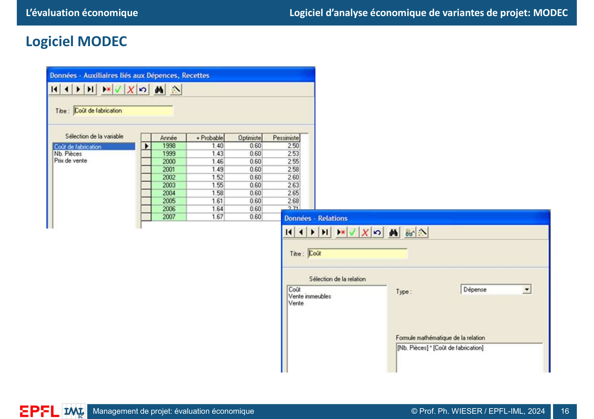

*Support, p. 16.* L'écran distingue le coût de fabrication unitaire, le nombre de pièces et le prix de vente. La relation « Coût » a le type « Dépense » et vaut « Nb. Pièces » multiplié par « Coût de fabrication ». En 1998, le coût unitaire central affiché est 1,40, avec 0,60 en optimiste et 2,50 en pessimiste. L'interface contient aussi les relations « Vente immeubles » et « Vente ». La formule de coût seule est lisible sur la capture. Elle montre comment une variation d'un auxiliaire modifie le flux qui en dépend.[^9]

### VAN déterministe et bande de sensibilité

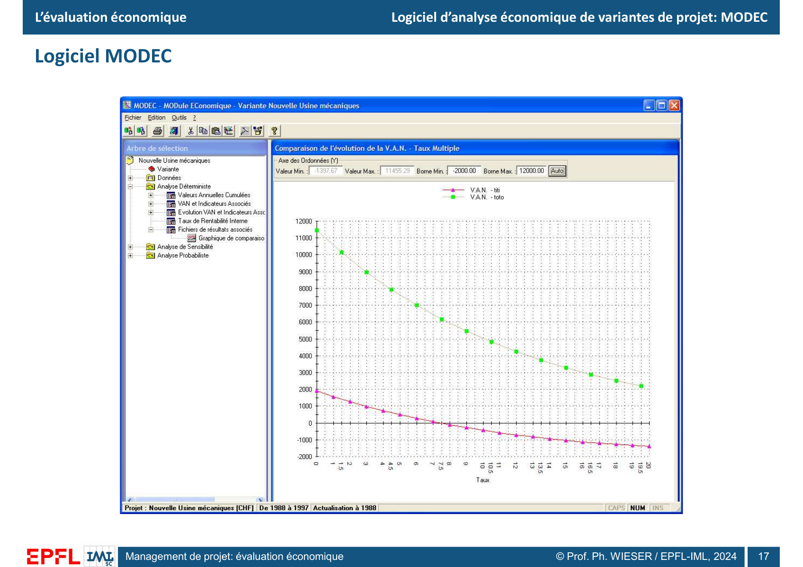

*Support, p. 17.* Dans cet écran de comparaison, la barre indique CHF, 1988–1997 et une actualisation à 1988. La courbe verte « toto » reste positive et au-dessus de la rose sur le domaine montré, jusqu'à 20 %. La courbe rose « titi » franchit zéro entre 7 % et 8 % à la lecture de l'image. On peut ainsi localiser approximativement son TIR, tandis que l'écran ne montre aucun TIR pour la courbe verte sur la plage testée. Les valeurs précises du flux de ces variantes ne sont pas affichées.[^9]

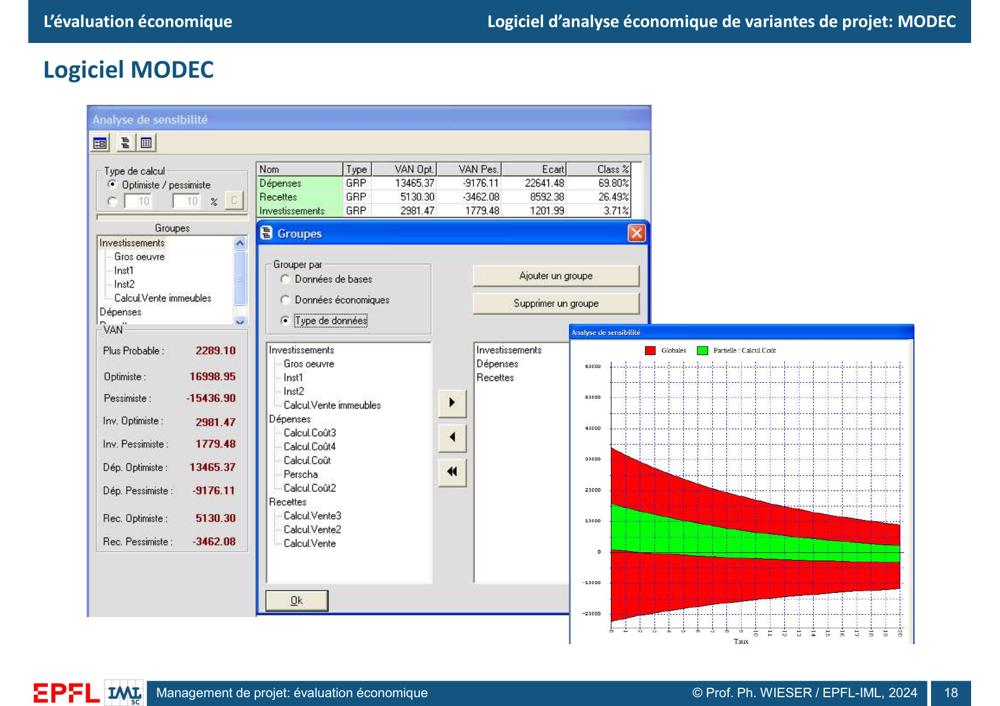

*Support, p. 18.* MODEC propose de grouper les entrées par données de base, données économiques ou types de données. Le mode « Optimiste / pessimiste » est sélectionné. Un autre mode utilise des variations en pourcentage. Les groupes de la capture sont les investissements (gros œuvre, installations, calcul de vente d'immeubles), dépenses (relations de coût et Perscha) et recettes (relations de vente). À droite, le rouge trace la bande globale selon le taux et le vert la bande partielle « Calcul.Coût ». Il s'agit de résultats de sensibilité pour les plages testées.[^9]

La VAN affichée comme « Plus probable » vaut 2 289,10. La combinaison globale optimiste donne 16 998,95, et la pessimiste −15 436,90. Le passage de positif à négatif justifie l'examen des hypothèses. Le classement de l'écran peut être reproduit par les écarts de VAN entre les deux évaluations de chaque groupe.[^9]

| Groupe | VAN optimiste | VAN pessimiste | Écart | Classement affiché |
|---|---:|---:|---:|---:|
| Dépenses | 13 465,37 | −9 176,11 | 22 641,48 | 69,80 % |
| Recettes | 5 130,30 | −3 462,08 | 8 592,38 | 26,49 % |
| Investissements | 2 981,47 | 1 779,48 | 1 201,99 | 3,71 % |

**Calcul à partir de la capture.** Les écarts somment à 32 435,85, soit aussi $16\,998{,}95-(-15\,436{,}90)$. Pour les dépenses, $22\,641{,}48/32\,435{,}85\approx69{,}80\,\%$. Ce classement reproduit les parts d'écart de cette comparaison. Il ne donne ni une probabilité de dépassement des dépenses, ni une part de variance expliquée. L'addition des écarts par groupe n'est pas générale. Elle peut échouer si le même auxiliaire affecte plusieurs groupes ou si le résultat comporte des interactions.[^9][^13]

### Paramétrer une simulation et interpréter ses sorties

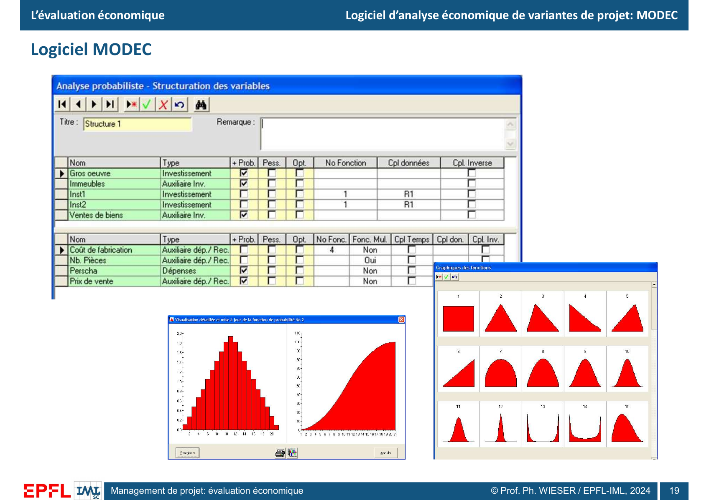

*Support, p. 19.* Certaines lignes prennent la valeur la plus probable de façon fixe. Les lignes Inst1 et Inst2 portent le numéro de fonction 1 et un même identifiant de couplage R1. Le coût de fabrication porte le numéro 4. Des colonnes prévoient le couplage dans le temps, entre données et en sens inverse. La bibliothèque affiche des formes rectangulaire, triangulaires et asymétriques, entre autres. Pour la fonction no 2, l'écran montre une représentation en barres et la courbe cumulée associée. Les numéros sont des références de fonctions dans l'exemple. La capture ne suffit pas pour reconstituer toutes les lois, leurs paramètres et le traitement exact des couplages.[^9]

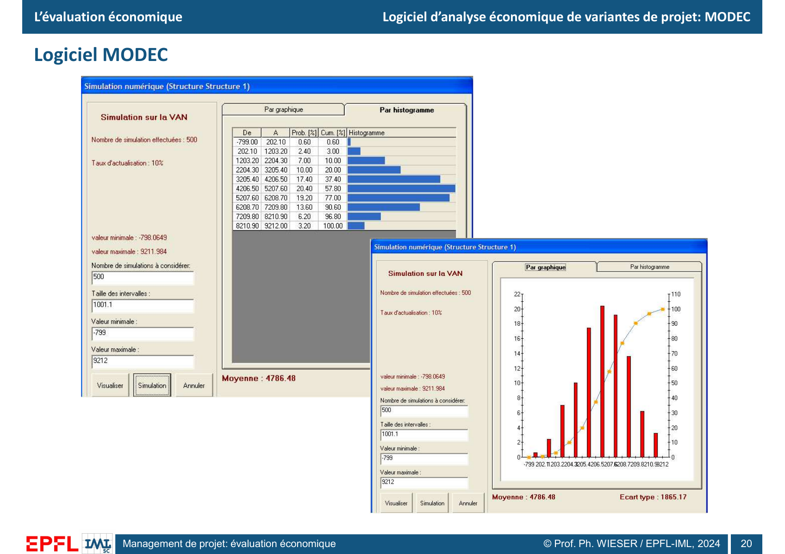

*Support, p. 20.* L'écran indique 500 simulations au taux de 10 %, une moyenne de 4 786,48 et un écart type de 1 865,17. Le minimum observé vaut −798,0649 et le maximum 9 211,984. La capture ne précise pas d'unité monétaire pour ces résultats. Les classes s'étendent de −799 à 9 212, par pas de 1 001,1. Les barres rouges de la vue de droite indiquent des fréquences par classe, et la courbe cumulative monte à 100 % sur l'axe de droite. Le tableau de gauche donne les deux lectures en pourcentage.[^9]

| Classe de VAN, bornes affichées | Fréquence dans la classe | Cumul à la fin de la classe | Nombre de tirages déduit |
|---|---:|---:|---:|
| −799,00 à 202,10 | 0,60 % | 0,60 % | 3 |
| 202,10 à 1 203,20 | 2,40 % | 3,00 % | 12 |
| 1 203,20 à 2 204,30 | 7,00 % | 10,00 % | 35 |
| 2 204,30 à 3 205,40 | 10,00 % | 20,00 % | 50 |
| 3 205,40 à 4 206,50 | 17,40 % | 37,40 % | 87 |
| 4 206,50 à 5 207,60 | 20,40 % | 57,80 % | 102 |
| 5 207,60 à 6 208,70 | 19,20 % | 77,00 % | 96 |
| 6 208,70 à 7 209,80 | 13,60 % | 90,60 % | 68 |
| 7 209,80 à 8 210,90 | 6,20 % | 96,80 % | 31 |
| 8 210,90 à 9 212,00 | 3,20 % | 100,00 % | 16 |

**Calcul à partir de la capture.** La classe la plus fréquente contient $0{,}204\times500=102$ tirages. La médiane empirique est dans cette classe puisque le cumul passe de 37,40 % à 57,80 %. Le 5e percentile tombe entre 1 203,20 et 2 204,30 selon les cumuls, sans valeur exacte à l'intérieur de la classe. La première classe contient trois observations et chevauche zéro. Le minimum confirme au moins une VAN négative. La proportion observée de VAN négatives se situe donc entre 0,20 % et 0,60 %, sans chiffre plus précis dans cet écran. Ces bornes portent sur les tirages de l'exemple. Elles ne forment pas un intervalle de confiance pour le risque réel. Les valeurs extrêmes observées ne bornent pas les résultats de futures simulations.[^9][^13]

**Lecture pédagogique.** On peut vérifier la somme des fréquences, lire un cumul et recalculer les effectifs depuis l'écran. Reproduire exactement la moyenne et l'écart type exige les résultats individuels ou le modèle et ses paramètres complets. La VAN centrale de la p. 18 et la moyenne de la p. 20 ne sont pas automatiquement comparables. Une valeur « la plus probable » de chaque entrée n'est pas une moyenne et les captures ne documentent pas un modèle et un taux identiques.

## 6. Le parking urbain de 500 places

**Contenu du cours.** Le cas final porte sur la construction d'un parking « souterrain » de 500 places en milieu urbain. Le plan de la p. 21 met en évidence un secteur à proximité du Bourg et de la Neuveville. La p. 22 ajoute des photos du relief, des constructions en surplomb, d'un mur et des bâtiments en contrebas. Le projet doit donc se lire en coupe autant qu'en plan. Les images donnent le contexte spatial et aucune donnée chiffrée de coût, de sol ou de fréquentation.[^10]

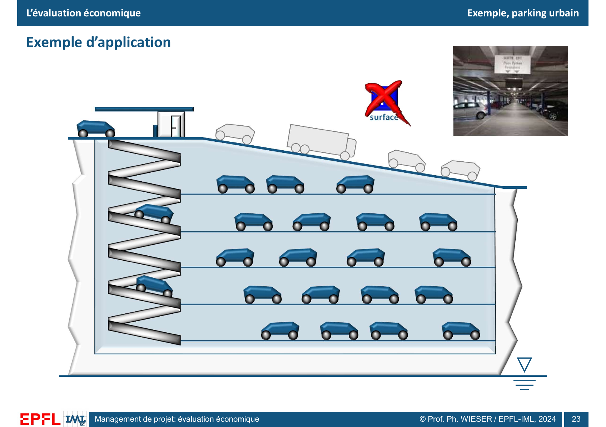

*Support, p. 23.* La rampe en zigzag dessert plusieurs niveaux de stationnement. En surface, le dessin montre une circulation sur une pente et barre le pictogramme de parking de surface. Une ligne basse et un symbole évoquent un niveau d'eau dans la coupe. La photo en encadré illustre l'intérieur d'un parking. Le visuel invite à distinguer le stationnement de surface du stationnement en ouvrage et à poser la question des interfaces avec le terrain. Le symbole ne suffit pas pour établir le niveau de la nappe ni les contraintes géotechniques du site.[^10]

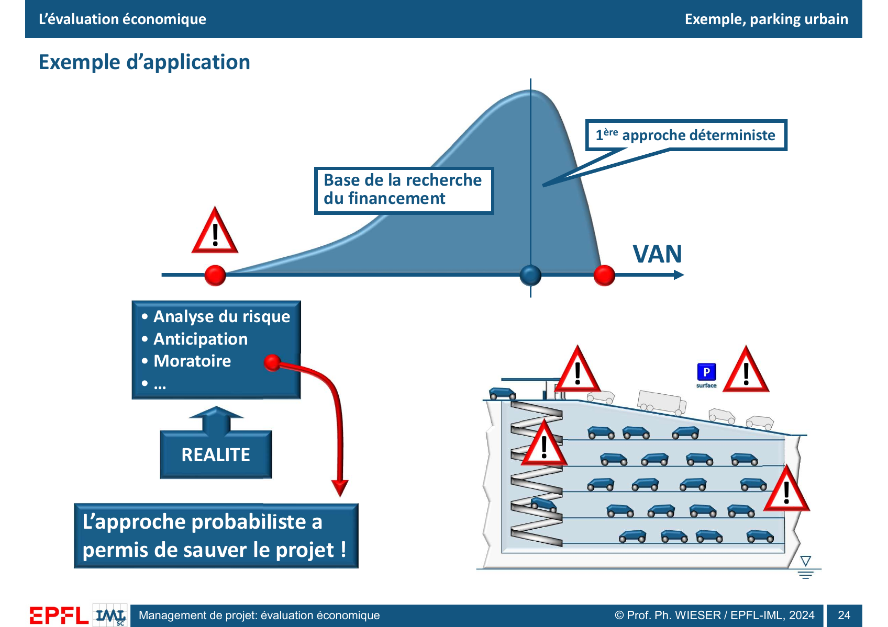

*Support, p. 24.* La distribution a une longue queue vers les faibles VAN. Le point bleu au voisinage du sommet est associé à la première approche déterministe. Le texte « Base de la recherche du financement » apparaît au sein du dessin sans valeur chiffrée ni règle de sélection d'un quantile. Il indique le lien avec le financement, distinct de l'estimation ponctuelle et du scénario bas signalé en rouge. Les triangles d'alerte apparaissent près de plusieurs interfaces de la coupe, sans légende qui les attribue à des risques précis. Le pictogramme de parking de surface réapparaît et la vignette « Réalité » renvoie à « Analyse du risque », « Anticipation » et « Moratoire ». Selon la conclusion de la diapositive, l'approche probabiliste « a permis de sauver le projet ». Le support ne donne ni le contenu exact du moratoire, ni une probabilité de VAN négative, ni le déroulement administratif, financier ou opérationnel ultérieur.[^10]

**Lecture pédagogique.** Une VAN déterministe près du sommet de la distribution peut servir de première estimation pour chercher des ressources, alors que la queue basse appelle des mesures préparées à l'avance. Le cas illustre l'intérêt de relier des scénarios à une décision. Un moratoire peut être étudié comme une pause avec des critères explicites de reprise, par exemple attendre une donnée technique ou une décision publique. Cette lecture explique l'outil de décision sans attribuer un déclencheur particulier au projet présenté.[^8][^10]

| Variable à examiner, exemples pédagogiques | Effet dans l'échéancier | Décision à éclairer |
|---|---|---|
| Conditions de terrassement ou gestion de l'eau | Hausse de $I_t$, retard de l'ouverture, coût de pompage ou de maintenance. | Réaliser une investigation complémentaire et tester une autre conception. |
| Capacité de 500 places, fréquentation et durée de séjour | Les recettes dépendent des heures facturées, du tarif et des abonnements. La capacité donne une limite physique et ne garantit aucun remplissage. | Tester une demande basse, le phasage ou un nombre de places différent. |
| Disponibilité du stationnement de surface | Modification possible de la demande en ouvrage et de l'usage de la voirie. | Traiter chaque politique de surface comme un scénario explicite. |
| Accès, voisinage et calendrier des autorisations | Restrictions de chantier et report de recettes, dépenses ou adaptations supplémentaires. | Conditionner l'engagement des fonds à des études, décisions et dates vérifiables. |
| Conditions de financement | Besoin maximal de trésorerie, coût de dette, capacité à faire face aux remboursements. | Construire un plan financier séparé et tester le scénario de retard. |

Pour chiffrer les recettes d'un parking à l'heure, on peut commencer par $R_t=p_t h_t$ avec $h_t$ les heures effectivement facturées et $p_t$ le prix moyen par heure. Avec 500 places, $h_t$ est au plus égal à 500 multiplié par le nombre d'heures d'ouverture, avant de tenir compte des places réservées, fermées ou gratuites. Si les abonnements sont modélisés à part, excluez les heures déjà couvertes de la recette horaire. Ce calcul pédagogique transpose la décomposition « quantité × prix » de la p. 3. Le cas du cours ne donne ni $p_t$ ni $h_t$.[^3][^10]

## 7. Questions d'entraînement

| Question | Réponse attendue |
|---|---|
| Pourquoi deux variantes de même gain nominal peuvent-elles avoir des VAN différentes ? | Les dates changent la valeur actuelle de chaque flux. Au même taux positif, une recette reportée est moins valorisée. |
| Comment traiter une cession au terme du projet ? | L'inscrire comme valeur résiduelle nette actualisée, ou comme recette finale dans l'échéancier, une seule fois. |
| Une variante de TIR plus élevé a-t-elle toujours une VAN plus élevée ? | Le classement par taux peut différer du classement par montant. Dans l'exemple, A a un TIR plus élevé et B une VAN plus forte à 10 %. |
| Où lire le TIR et la DRCI ? | Le TIR se lit au zéro d'une courbe de VAN en fonction du taux. La DRCI se lit au premier zéro du cumul des flux actualisés en fonction du temps. |
| Un taux exigé de 12 % suffit-il à rejeter un TIR de 10 % ? | Oui par le critère VAN si les flux sont conventionnels et la VAN décroissante. Avec plusieurs racines, calculez directement la VAN à 12 %. |
| Une bande de VAN optimiste et pessimiste donne-t-elle la probabilité de perte ? | Les bornes montrent les conséquences des hypothèses testées. Une probabilité exige des poids de scénarios ou une loi jointe. |
| Pourquoi conserver le même choc de demande pour comparer deux variantes au même emplacement ? | Elles font face à la même demande dans chaque scénario. Comparer deux chocs indépendants inventerait un autre mécanisme de risque. |
| La première classe de l'histogramme MODEC contient 0,60 % des résultats. Peut-on annoncer 0,60 % de VAN négatives ? | Non. La classe contient des valeurs de part et d'autre de zéro. Le minimum est négatif et une à trois des 500 observations sont négatives. |
| Une moyenne positive garantit-elle la capacité de financement ? | La moyenne n'indique ni le pire besoin de liquidité, ni les dates d'exigibilité, ni la taille de la perte dans les scénarios défavorables. |

## Couverture des 24 diapositives

| Diapo | Élément repris | Section |
|---:|---|---|
| 1 | Titre, auteur, millésime et horizon incertain. | Ouverture |
| 2 | Cycle, marge de manœuvre, coûts, approches, critères, risque. | 1 |
| 3 | Échéancier, conventions de signe, données primaires. | 1, 6 |
| 4 | Quatre variantes graphiques, question du choix. | 1 |
| 5 | VAN, actualisation des composantes et valeur résiduelle. | 2 |
| 6 | VAN, TIR, flux actualisé, cumul, DRCI. | 2, 3 |
| 7 | Portée comparative et économique, financement, ROI. | 2, 3 |
| 8 | Choix A/B et trois approches. | 4 |
| 9 | Résultat ponctuel, plage et distribution. | 4 |
| 10 | Variation et classement, bande de VAN en fonction du taux. | 4 |
| 11 | Classement des entrées et calibration éventuelle des lois. | 4 |
| 12 | Échéancier, données déterministes ou probabilistes, lois et couplages. | 4 |
| 13 | Fonction cumulée, tirages, histogramme et intervalle. | 4 |
| 14 | Arbre MODEC, métadonnées et sorties de la variante. | 5 |
| 15 | Investissements par année et durée, dépenses annuelles, valeurs de référence et bornes. | 5 |
| 16 | Auxiliaires et relations de coût et de vente. | 5 |
| 17 | Comparaison de profils de VAN pour plusieurs taux. | 5 |
| 18 | Analyse par groupe, écarts et bandes globale et partielle. | 5 |
| 19 | Structuration des variables, couplages, choix de fonction et cumul. | 5 |
| 20 | 500 tirages de VAN, histogramme, cumul, moyenne et dispersion. | 5 |
| 21 | Parking de 500 places et localisation sur la carte. | 6 |
| 22 | Photos du relief et de l'environnement construit. | 6 |
| 23 | Coupe du parking, rampe, circulation et interface avec la surface. | 6 |
| 24 | Cas déterministe, financement, scénario bas, anticipation et moratoire. | 6 |

## Références

[^1]: Philippe Wieser, *Évaluation économique d'un projet. Choix d'investissement en horizon incertain*, EPFL-CDM-IML, millésime imprimé 2024, [support de 24 pages](../slides/4_MGT_427_eco_26.pdf), p. 1. Les numéros de diapositive coïncident avec les pages du PDF.
[^2]: Wieser, même support, p. 2. Courbes de marge de manœuvre et de coûts cumulés, approches d'évaluation et risque.
[^3]: Wieser, même support, p. 3–4. Échéanciers et combinaison des données primaires.
[^4]: Wieser, même support, p. 5–6. VAN, valeur résiduelle, TIR, DRCI et flux actualisés.
[^5]: Wieser, même support, p. 7. Périmètre du projet, critères et ROI.
[^6]: Wieser, même support, p. 8–9. Comparaison de variantes et trois approches.
[^7]: Wieser, même support, p. 10–11. Sensibilité et calibration éventuelle.
[^8]: Wieser, même support, p. 12–13. Structuration, couplages et principe de la simulation.
[^9]: Wieser, même support, p. 14–20. Captures du logiciel MODEC et résultats d'illustration.
[^10]: Wieser, même support, p. 21–24. Exemple d'application du parking urbain.
[^11]: Banque mondiale, *Handbook on Economic Analysis of Investment Operations*, [manuel et annexe technique](https://ppp.worldbank.org/public-private-partnership/sites/ppp.worldbank.org/files/2022-05/Handbook-Economic-Analysis-Investment-Operations.pdf). Voir « Discounting and Comparing Alternative Projects » pour l'actualisation, le TIR et les variantes exclusives.
[^12]: Banque interaméricaine de développement, [Cost-Benefit Analysis](https://www.iadb.org/en/results-and-effectiveness/development-effectiveness/project-evaluation/cost-benefit-cost-effectiveness/cost-benefit-analysis), critères d'investissement, analyse de sensibilité et valeurs de bascule. Commission européenne, [Economic Appraisal Vademecum 2021–2027](https://op.europa.eu/en/publication-detail/-/publication/cf2c28fe-484e-11ed-92ed-01aa75ed71a1), cadre d'évaluation des investissements et choix du point de vue.
[^13]: U.S. Government Accountability Office, [Cost Estimating and Assessment Guide, GAO-20-195G](https://www.gao.gov/assets/gao-20-195g.pdf), chapitres 11 et 12 sur l'analyse de sensibilité et l'analyse des risques et de l'incertitude.
[^14]: U.S. Army Corps of Engineers, *HEC-FIA Technical Reference Manual*, [Computational Inputs (Monte Carlo Application)](https://www.hec.usace.army.mil/confluence/fiadocs/fiatechref/latest/monte-carlo-application/computational-inputs-monte-carlo-application), distributions, inversion de la fonction cumulée et convergence des simulations.
