# Planification et ordonnancement de projet

Comment passer d'une liste de travaux à une date de livraison défendable ? Le calcul du réseau commence par les dépendances et les durées. Le projet doit ensuite confronter cette première prévision aux calendriers, à la capacité disponible et aux aléas. Cette fiche suit le support de Philippe Wieser, dont le fichier porte le suffixe 26 et dont les diapositives sont datées de 2020. Les développements signalés comme **compléments pédagogiques** prolongent le support. Les numéros de page et de diapositive coïncident.[^1]

## 1. De la variante à un réseau calculable

### 1.1 Planifier avant de retenir une variante

Le cours place l'organisation et la planification parmi les approches technique, économique, environnementale et sociale utilisées pour comparer des variantes. Le graphique superpose deux courbes conceptuelles sans échelle chiffrée. Les coûts cumulés augmentent au fil de l'étude, de la réalisation et de l'exploitation. La marge de manœuvre décroît quand les choix deviennent difficiles à inverser. Une flèche d'analyse des risques traverse les phases. Les délais et les besoins de ressources estimés pendant l'étude alimentent l'analyse multicritère. Une fois la variante retenue, l'équipe reprend son réseau, détaille les processus et s'en sert pour le suivi.[^2][^10]

**Complément pédagogique.** Une option moins chère à l'achat peut exiger une installation pendant la fermeture du site. Une option plus chère peut libérer un créneau pour un essai obligatoire. Évaluez les variantes avec les mêmes hypothèses de disponibilité, et faites apparaître les compromis entre coût, durée et risque.

### 1.2 Liste, ordonnancement et planification

Dans le puzzle du cours, les pièces dispersées représentent les activités. Les liens logiques les organisent. L'axe $f(t)$ donne ensuite une position dans le temps. Les termes se recouvrent parfois en pratique. Pour les exercices, distinguez les trois résultats suivants.[^2]

| Résultat | Question | Exemple pédagogique |
|---|---|---|
| Liste des activités | Quel travail faut-il réaliser ? | Commander les écrans, poser les supports, tester la diffusion. |
| Ordonnancement | Quels travaux doivent précéder quels autres ? | L'essai de diffusion attend le raccordement. |
| Planification | À quelles dates placer le travail et avec quels moyens ? | L'essai a lieu jeudi, quand le site et le technicien sont disponibles. |

Les contraintes physiques viennent du procédé. Les contraintes administratives dépendent par exemple d'un permis. Les contraintes exogènes proviennent de l'environnement du projet, comme une fermeture du site. Une seule grue limite les travaux simultanés. La sécurité peut exiger une inspection avant toute utilisation. Selon la contrainte, le modèle emploie un lien, un calendrier, une limite de capacité ou un jalon.[^2]

### 1.3 Le PERT étendu

PERT signifie *Program Evaluation and Review Technique*. Le support propose aussi le terme *Project*. La méthode a été développée à la fin des années 1950 pour la marine américaine dans le cadre du programme Polaris. Le « PERT étendu » du support désigne une démarche de planification en onze opérations. Le calcul du plus long chemin avec des durées fixées relève du raisonnement CPM (*Critical Path Method*). La méthode PERT historique traite également l'incertitude des durées.[^3][^14][^15]

| Opérations du cours | Résultat |
|---|---|
| 1. Identifier les activités. 2. Les organiser, planifier et ordonnancer. 3. Construire le réseau. | Périmètre de travail et dépendances explicites. |
| 4. Évaluer les durées. 5. Déterminer les calendriers. 6. Calculer le réseau. | Durée, chemin critique et marges. |
| 7. Évaluer les consommations par activité. 8. Recalculer avec les contraintes de ressources. 9. Lisser les charges. | Calendrier compatible avec les moyens ou conflits à arbitrer. |
| 10. Évaluer et quantifier les risques. 11. Suivre et contrôler l'avancement. | Prévision de risque et mise à jour à partir des observations. |

## 2. Décomposer le travail et représenter les dépendances

### 2.1 WBS, détail et agrégation

En **top-down**, on décompose les activités générales de l'avant-projet jusqu'au niveau de détail nécessaire. En **bottom-up**, on regroupe les activités d'un réseau détaillé dans des blocs logiques. Le dessin du cours agrège trois sous-réseaux en $A_1$, $A_2$ et $A_3$. Le support emploie « activité hamac » pour ces regroupements. Les quatre captures illustrent l'usage de lignes récapitulatives et de sous-tâches, par exemple pour la conception, le développement et la recette d'un projet, ou pour des lots d'aménagement intérieur.[^4]

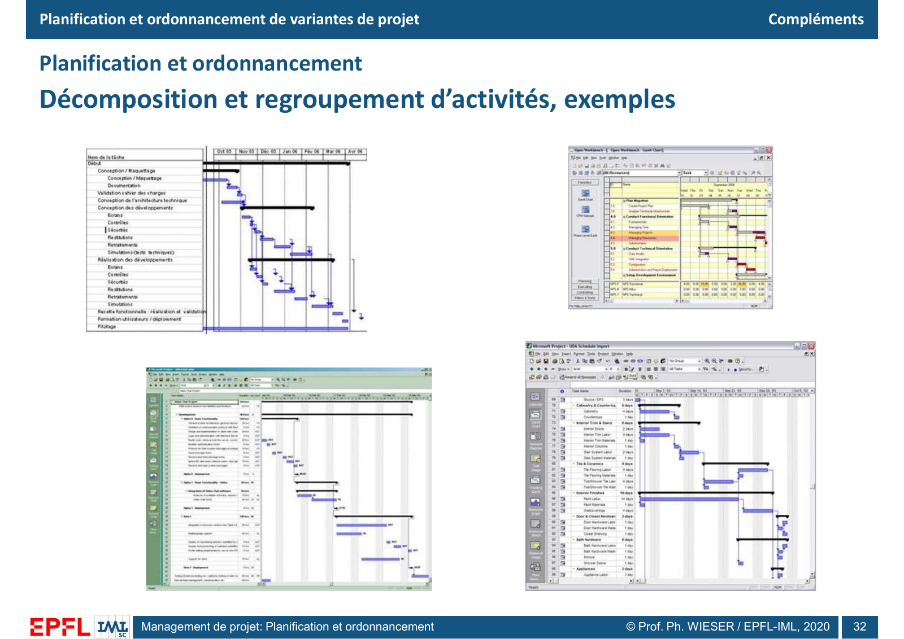

*Figure 1. Diapositive 32. Les barres récapitulatives donnent les bornes des groupes. Les lignes détaillées portent les travaux et leurs liens. Les sous-tâches peuvent se chevaucher.*[^4]

**Complément pédagogique.** Une WBS (*Work Breakdown Structure*, structure de découpage du travail) organise tout le périmètre en ensembles et sous-ensembles, souvent orientés vers les livrables. Le réseau situe les activités qui produisent ces livrables. Une branche « diffusion » regroupe installation et tests. Le test peut dépendre d'un accès situé dans une autre branche. Une tâche récapitulative couvre généralement du début le plus précoce à la fin la plus tardive de ses composantes. Trois tâches simultanées de deux jours donnent ainsi une étendue de deux jours pour le groupe et six jours si l'on additionne leurs durées. Certains logiciels emploient *hamac* pour une activité suspendue à deux événements dont les dates commandent son étendue.[^4][^16]

### 2.2 Potentiels-étapes et potentiels-activités

Dans le formalisme initial, les activités sont sur les arcs et les étapes aux nœuds. Sur la diapositive 6, $A$ va de 1 à 2, $B$ de 2 à 3, $C$ de 4 à 5 et $D$ de 5 à 6. Un arc fictif de durée nulle relie 5 à 2. Il oblige $B$ à attendre $C$ en plus de $A$ et ne consomme aucune ressource. Le formalisme à potentiels-activités place les tâches dans les nœuds et donne directement $A\to B$, $C\to B$ et $C\to D$. Le support distingue le lien logique $C\to B$ et le lien physique $C\to D$.[^5]

Un chemin suit des liens de bout en bout. Deux activités parallèles peuvent s'exécuter en même temps si leurs prédécesseurs sont terminés et les ressources disponibles. Lorsque plusieurs liens fin-début convergent, le successeur attend le dernier à finir. Avec des durées positives, une boucle $A\to B\to A$ de tels liens rend le planning impossible. Au contrôle du réseau, recherchez aussi les branches sans lien vers la fin, les dépendances manquantes et les dates imposées qui empêchent la propagation d'un retard.[^16]

### 2.3 Liens fin-début et décalages

Le cours compare le fin-début standard entre $E$ et $F$ avec deux dessins où le point d'accrochage est décalé du côté de $E$ ou du côté de $F$. Le premier cas décalé peut se modéliser par un jalon interne de $E$ qui libère $F$. Dans le second, une étape de $F$ peut attendre la fin de $E$ alors que $F$ a déjà commencé. Un découpage explicite aide à distinguer les travaux qui peuvent avancer et ceux qui doivent attendre.[^12]

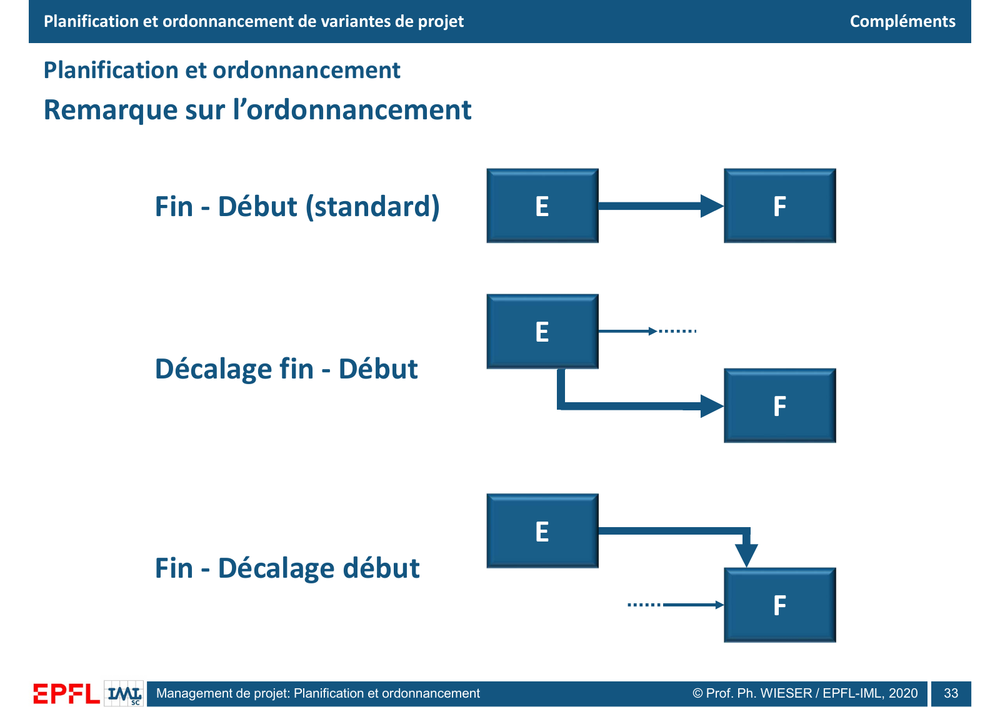

*Figure 2. Diapositive 33. La flèche épaisse part d'un autre point de $E$ dans le dessin médian et arrive sur un autre point de $F$ dans le dernier. Le support ne donne aucune valeur de décalage.*[^12]

**Complément pédagogique.** Avec $s_i$ et $f_i$ les instants de début et de fin du prédécesseur, un décalage algébrique $\ell$ s'ajoute au repère. En fin-début, si $i$ finit à 7, un délai de 2 donne un premier début de $j$ à 9 et une avance de 2 donne une borne à 5. Cette dernière autorise un recouvrement. Si une attente doit être mesurée et suivie, comme un séchage, une activité explicite peut mieux la représenter.[^16][^17]

| Lien de $i$ vers $j$ | Contrainte avec décalage $\ell$ | Exemple pédagogique |
|---|---|---|
| Fin-début (FD, *FS*) | $s_j\ge f_i+\ell$ | Attendre deux jours après la fin d'un traitement. |
| Début-début (DD, *SS*) | $s_j\ge s_i+\ell$ | Lancer le contrôle un jour après le démarrage de la ligne. |
| Fin-fin (FF) | $f_j\ge f_i+\ell$ | Achever le contrôle au plus tôt quand la production est terminée. |
| Début-fin (DF, *SF*) | $f_j\ge s_i+\ell$ | La surveillance de l'ancienne équipe se poursuit jusqu'à l'arrivée de la relève. |

## 3. Calculer les dates et les marges

### 3.1 Notation et hypothèses

Sur la boîte du cours, les dates au plus tôt sont en haut, les dates au plus tard en bas. Les débuts sont à gauche, les fins à droite. La durée figure au pied de la boîte. La fiche définit $Ft$ comme la fin de travail au plus tôt de l'activité elle-même. Une autre valeur apparaît parfois au même emplacement dans les figures du support, comme expliqué en section 3.4.[^5][^6]

| Symbole | Signification | Équivalent anglais |
|---|---|---|
| $d_i$ | Durée de l'activité $i$. | Duration |
| $Dt_i$ | Premier instant de début possible. | ES, *Early Start* |
| $Ft_i$ | Premier instant de fin, soit $Dt_i+d_i$. | EF, *Early Finish* |
| $DT_i$ | Dernier instant de début compatible avec la date de fin retenue. | LS, *Late Start* |
| $FT_i$ | Dernier instant de fin compatible avec cette date. | LF, *Late Finish* |
| $ML_i$, $MT_i$ | Marge libre, marge totale. | Free float, total float |

L'exemple suppose des durées fixes, un calendrier continu, aucune restriction de ressources et des liens fin-début sans décalage. L'origine est $t=0$. L'intervalle $[0,2)$ couvre les cases 1 et 2 du Gantt. La case 3 commence à $t=2$.

### 3.2 Passage en avant et passage en arrière

Soient $\mathrm{Pred}(i)$ et $\mathrm{Succ}(i)$ les prédécesseurs et successeurs immédiats de $i$. L'activité initiale commence à 0. Chaque prédécesseur $j$ impose $Dt_i\ge Ft_j$. On retient la borne la plus exigeante, donc le maximum.[^6][^15][^16]

$$
Dt_i=\max_{j\in\mathrm{Pred}(i)}Ft_j,\qquad Ft_i=Dt_i+d_i.
$$

Pour le retour, fixez $FT$ de la dernière tâche ou du jalon de fin à la date retenue $T^\ast$. Ici, c'est la première fin réalisable. Chaque successeur $k$ impose $FT_i\le DT_k$. Le minimum donne la dernière date compatible avec tous les successeurs. Soustrayez ensuite la durée.[^6][^15][^16]

$$
FT_i=\min_{k\in\mathrm{Succ}(i)}DT_k,\qquad DT_i=FT_i-d_i.
$$

Si plusieurs tâches terminent le projet, reliez-les à un jalon final de durée nulle. Si la date exigée précède la première fin réalisable, le calcul peut produire des marges négatives. Elles mesurent l'écart à résorber et signalent que les hypothèses actuelles ne permettent pas de tenir la date.

### 3.3 L'exemple A à H recalculé

$A$ libère $B$, $E$ et $G$. $B$ alimente $C$ et $F$. $E$ alimente aussi $F$. $G$ précède $H$. $C$, $F$ et $H$ doivent être terminées avant $D$. Le lien $B\to F$ détermine le départ de $F$ au plus tôt.[^6]

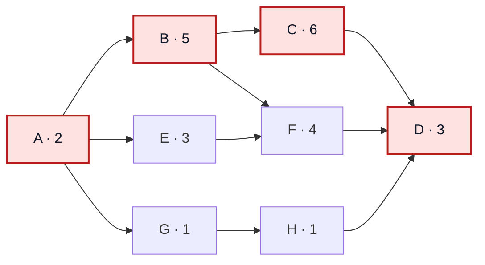

Au passage en avant, $Ft_B=7$ et $Ft_E=5$, donc $Dt_F=\max(7,5)=7$ et $Ft_F=11$. $C$ finit à 13 et $H$ à 4. Ainsi, $Dt_D=\max(13,11,4)=13$ et $Ft_D=16$. Au retour, $DT_D=13$. Il en découle $FT_F=13$ et $DT_F=9$, puis $FT_E=9$ et $DT_E=6$. Pour $B$, les deux successeurs imposent $FT_B=\min(9,7)=7$.

| Activité | Prédécesseurs | $d$ | $Dt$ | $Ft$ | $DT$ | $FT$ | $ML$ | $MT$ |
|---|---|---:|---:|---:|---:|---:|---:|---:|
| A | Aucun | 2 | 0 | 2 | 0 | 2 | 0 | 0 |
| B | A | 5 | 2 | 7 | 2 | 7 | 0 | 0 |
| C | B | 6 | 7 | 13 | 7 | 13 | 0 | 0 |
| D | C, F, H | 3 | 13 | 16 | 13 | 16 | 0 | 0 |
| E | A | 3 | 2 | 5 | 6 | 9 | 2 | 4 |
| F | B, E | 4 | 7 | 11 | 9 | 13 | 2 | 2 |
| G | A | 1 | 2 | 3 | 11 | 12 | 0 | 9 |
| H | G | 1 | 3 | 4 | 12 | 13 | 9 | 9 |

La somme des huit durées est de 25 unités. Le projet prend **16 unités** grâce à l'exécution parallèle. Le chemin $A\to B\to C\to D$ dure 16, $A\to B\to F\to D$ dure 14, $A\to E\to F\to D$ dure 12 et $A\to G\to H\to D$ dure 7. Le plus long impose la durée minimale du projet dans ce modèle. Allonger une tâche de ce chemin d'une unité allonge ici le projet d'une unité.[^6]

### 3.4 Marge libre, marge totale et notation du support

La **marge libre** est le retard maximal d'une activité placée au plus tôt qui conserve les débuts au plus tôt de tous ses successeurs immédiats. La **marge totale** est le retard maximal qui conserve la date finale, quitte à déplacer les successeurs.[^6][^16]

$$
ML_i=\min_{k\in\mathrm{Succ}(i)}Dt_k-Ft_i,\qquad
MT_i=DT_i-Dt_i=FT_i-Ft_i.
$$

Pour la dernière tâche, le jalon de fin fixé à 16 donne $ML_D=0$. Pour $E$, on obtient $ML_E=7-5=2$ et $MT_E=9-5=4$. Déplacer $E$ de 2 à 4 conserve le début de $F$ à 7. Déplacer $E$ de 2 à 6 pousse $F$ à 9. $F$ finit alors à 13, juste à temps pour $D$. Les marges totales de $E$ et $F$ sont donc liées. Pour $G$, tout retard pousse $H$, d'où $ML_G=0$, mais la branche peut absorber neuf unités avant de faire attendre $D$.[^6]

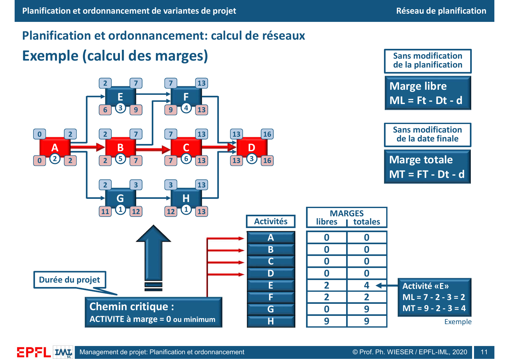

*Figure 3. Diapositive 11. A–B–C–D est en rouge. Le 7 à droite de $E$ est la borne posée par le début au plus tôt de $F$. La fin de travail d'$E$ vaut $2+3=5$.*[^6]

**Lecture critique.** La diapositive 8 affiche la fin calculée et une borne aval encadrée pour $E$, $F$ et $H$. Les pages 9 à 12 réutilisent la zone supérieure droite pour la borne aval, soit 7, 13 et 13 au lieu des fins de travail 5, 11 et 4. La formule $ML=Ft-Dt-d$ du support fonctionne avec cette borne pour premier terme. Avec le sens strict de la diapositive 7, $Ft=Dt+d$, la même formule donnerait toujours zéro. Les formules de la fiche distinguent les deux quantités.[^5][^6]

Une marge **totale** nulle signale ici une activité critique. Le cours parle aussi d'activités à marge minimale. Avec une borne externe ou plusieurs chemins contraints, vérifiez la chaîne qui gouverne le jalon. Plusieurs chemins peuvent être critiques ensemble. Accélérer un seul d'entre eux peut laisser l'autre imposer la même durée.[^6][^16]

## 4. Lire et communiquer un Gantt

Le réseau facilite le calcul et montre les dépendances. L'espacement de ses boîtes n'est pas une échelle de temps. Le Gantt représente les mêmes activités sur un axe temporel. Dans le Gantt au plus tôt, le rouge désigne les tâches critiques. Les barres non critiques sont bleues, avec une marge libre bleu clair et une marge totale rose. Les deux prolongements partent de la fin du travail et se lisent séparément.[^7]

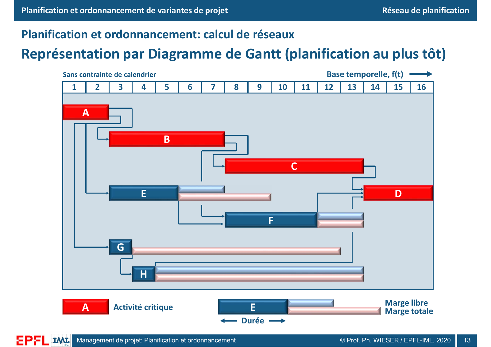

*Figure 4. Diapositive 13. $E$ occupe les cases 3 à 5. Sa marge libre occupe 6 et 7, sa marge totale 6 à 9. Seule la marge totale est visible pour $G$.*[^7]

Au plus tard, $E$ occupe $[6,9)$, $F$ $[9,13)$, $G$ $[11,12)$ et $H$ $[12,13)$. Les contours de la diapositive 14 rappellent leurs positions au plus tôt. Les tâches critiques gardent leurs dates. Ce placement teste notamment l'effet d'un déplacement des charges en fin de planning. Il consomme les marges calculées. Le cours réserve les marges à la direction et présente le Gantt au plus tard comme indicatif et non diffusé. Pour le pilotage, le niveau de diffusion doit permettre aux personnes concernées de connaître leurs dates, les interfaces à respecter et les conditions d'escalade.[^7][^10]

## 5. Affecter les ressources et lisser la charge

### 5.1 Transformer les affectations en charge

Le support cite les ressources financières, humaines et matérielles, les machines et les équipements. Un stock consommé ou une enveloppe budgétaire se suit en cumul. Une équipe ou une machine dispose d'une capacité renouvelée par période. Les affectations et les calendriers de ressources peuvent changer le chemin critique, la durée, les marges et l'ordre des travaux.[^8]

Dans l'exemple, le taux de charge $r_i$ est constant pendant chaque activité et son travail vaut $w_i=r_i d_i$. Additionnez les taux des activités simultanées pour chaque case. Pour un début $s_i$ et une case $k$ couvrant $[k-1,k)$, le calcul suivant suppose des départs et des fins entiers.[^8][^9]

$$
L_k=\sum_i r_i\,\mathbf 1_{\{s_i\le k-1<s_i+d_i\}},
\qquad \bar L=\frac{\sum_k L_k}{T}=\frac{\sum_i w_i}{T}.
$$

| Activité | Durée | Taux de charge $r_i$ | Charge cumulée de l'activité $w_i$ |
|---|---:|---:|---:|
| A | 2 | 6 | 12 |
| B | 5 | 3 | 15 |
| C | 6 | 2 | 12 |
| D | 3 | 4 | 12 |
| E | 3 | 4 | 12 |
| F | 4 | 3 | 12 |
| G | 1 | 3 | 3 |
| H | 1 | 2 | 2 |
| Total | 25 unités d'activité | | 80 unités de charge cumulée |

Le 16 sous la colonne des durées à la diapositive 16 désigne la durée du **projet**. La charge moyenne est $\bar L=80/16=5$. Au plus tôt, la troisième case superpose $B$, $E$ et $G$. La charge vaut $3+4+3=10$. Dans la quatrième case, $H$ remplace $G$ et la charge descend à 9.[^8][^9]

### 5.2 Comparer deux profils de charge

La ligne rouge de la diapositive 19 indique la moyenne 5. On reproduit les indices « +13 » et « +11 » en additionnant uniquement les écarts positifs au-dessus de cette ligne.[^9]

| Placement | Charges des cases 1 à 16 | Pic | Indice de dépassement de 5 |
|---|---|---:|---:|
| Au plus tôt | 6, 6, 10, 9, 7, 3, 3, 5, 5, 5, 5, 2, 2, 4, 4, 4 | 10 | $1+1+5+4+2=13$ |
| Au plus tard | 6, 6, 3, 3, 3, 3, 7, 6, 6, 5, 5, 8, 7, 4, 4, 4 | 8 | $1+1+2+1+1+3+2=11$ |

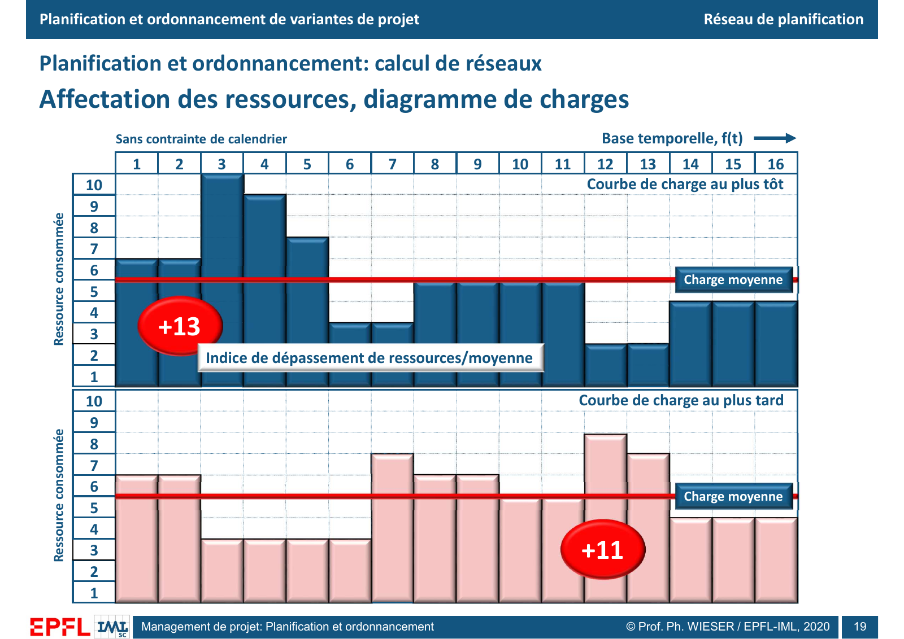

*Figure 5. Diapositive 19. Le placement tardif déplace les pointes vers la fin et réduit le pic de 10 à 8. La charge cumulée reste 80 et la durée reste 16.*[^9]

Pour juger la faisabilité, remplacez la moyenne par la capacité réelle $K_k$ à chaque case. L'excès cumulé vaut alors $\sum_k\max(0,L_k-K_k)$. Même si la moyenne vaut 5, une capacité uniforme de 5 ne permet pas d'exécuter $A$ à son taux de 6.

### 5.3 Refaire le calcul après le lissage

Le cours propose d'essayer d'abord des déplacements dans les marges libres, puis dans les marges totales. Si les charges restent incompatibles, envisagez un déplacement qui change la fin du projet selon les priorités, ou une augmentation des ressources. Un déplacement peut créer un conflit plus loin. Recalculez les dates et le profil après chaque scénario. Le lissage à date fixe se limite aux déplacements compatibles avec cette borne. Une capacité stricte peut obliger à allonger le projet.[^9][^16][^18]

**Complément pédagogique calculé.** Gardez les quatre tâches critiques à leurs dates et $G$, $H$ au plus tôt. Déplacez $E$ à $[6,9)$ et $F$ à $[9,13)$. Les charges deviennent $6,6,6,5,3,3,7,6,6,5,5,5,5,4,4,4$. La somme vaut 80, le pic vaut 7 et l'indice au-dessus de 5 vaut 7. $F$ commence bien après $B$ et $E$, puis se termine avec $C$ avant $D$.

Peut-on descendre à une capacité de 6 avec une fin à 16 ? Dans ce modèle à tâches non fractionnées, $E$ doit commencer entre 2 et 6. Elle chevauche donc $B$, qui occupe $[2,7)$. Leur charge simultanée vaut $4+3=7$. Pour tenir une capacité de 6, on peut placer $E$ sur $[7,10)$, $F$ sur $[10,14)$ et $D$ sur $[14,17)$. L'unité supplémentaire vient de $F$, qui se termine une unité après $C$.

## 6. Calendriers et jalons

### 6.1 Trois niveaux de calendrier

Le support distingue un calendrier général du projet, un calendrier propre à l'activité et un calendrier propre à la ressource, éventuellement à son affectation. Le premier peut exclure les week-ends, le second réserver des opérations à des créneaux de nuit et le troisième refléter la maintenance d'un équipement. Ces disponibilités peuvent rendre critique une branche auparavant secondaire. Le temps de travail se mesure dans les périodes ouvertes. Le temps calendaire écoulé comprend aussi les périodes fermées.[^8][^19]

**Exemple pédagogique.** Deux jours ouvrés commençant vendredi occupent vendredi et lundi sur un calendrier lundi-vendredi. Si la ressource indispensable est absente lundi et que le travail peut reprendre après l'interruption, le second jour de travail bascule à mardi. L'intervalle calendaire augmente alors que la durée de travail reste deux jours.

### 6.2 Construire à rebours depuis une borne

Un jalon signale un événement et se représente généralement par une durée nulle. Le cours met l'accent sur les bornes non modifiables, finales ou intermédiaires. Une manifestation sportive ou culturelle fixe par exemple son ouverture. En construisant à rebours, on part de l'ouverture et on demande quelles conditions doivent être remplies, puis à quelles dernières dates les opérations peuvent s'achever.[^8]

Le dessin montre l'ordre dans lequel on interroge les prérequis. L'ordre d'exécution va en sens inverse. Faites aussi un calcul en avant depuis les dates et calendriers réellement disponibles. Si la première fin réalisable dépasse la borne, fixez un arbitrage sur les ressources, la durée, le périmètre ou les dépendances. Saisir la date imposée dans un logiciel fait apparaître la contrainte et peut révéler l'écart.[^8][^16]

## 7. Suivre le travail et réviser la prévision

### 7.1 Lire le Gantt à la date du relevé

La ligne verticale du Gantt de suivi indique la **date du relevé**. Les portions blanches des barres matérialisent le pourcentage d'avancement mesuré. Le support entoure $C$ et demande des mesures, juge $F$ « OK » et surveille $H$. $C$ est critique et accuse un retard par rapport au repère. $F$ présente un avancement compatible avec le repère illustré. $H$ reste inachevée après son créneau initial, mais sa branche dispose de marge dans le plan de départ.[^10]

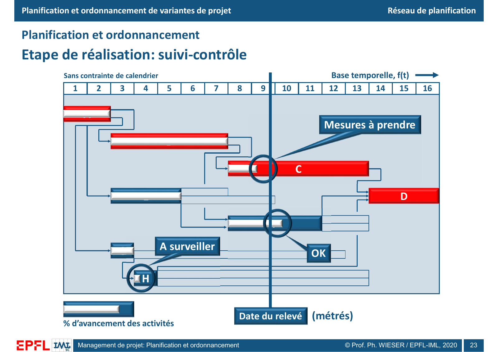

*Figure 6. Diapositive 23. Un retard sur $C$ peut atteindre $D$ immédiatement. Pour $H$, comparez le travail restant à la prochaine date de jonction.*[^10]

**Complément pédagogique.** Si trois des quatre zones d'une installation sont terminées, le relevé peut annoncer 75 % du volume. Si la quatrième concentre les travaux difficiles, elle peut demander la moitié de l'effort total. Pour prévoir la suite, consignez les dates réelles, estimez la durée restante à la date du relevé et confirmez les ressources. Conservez une référence approuvée pour mesurer les écarts et un planning courant pour prévoir la fin. Une révision de la référence doit laisser une trace.[^16]

### 7.2 Présenter planning et budget au comité

Le schéma relie le comité de pilotage à la direction ou au chef de projet, lui-même en relation avec le groupe des utilisateurs. L'ordre du jour commence par le procès-verbal précédent. L'état d'avancement porte sur le planning et les finances, avec l'état présent et la prévision budgétaire. Présenter ces éléments ensemble permet d'examiner le coût d'une action correctrice en regard de la date menacée.[^10]

| Information à présenter | Exemple pédagogique |
|---|---|
| Réalisé à la date du relevé | Deux sections sur quatre ont été acceptées. |
| Prévision | L'essai recule d'un jour si l'équipe de raccordement reste indisponible. |
| Conséquence | La répétition exige un autre créneau de site. |
| Décision et responsable | Le comité décide du renfort. Le chef de projet vérifie le créneau et l'essai. |

### 7.3 Ce que montrent les captures de Microsoft Project

Les diapositives 25 à 28 présentent le réseau, le Gantt, la charge et le suivi sur un calendrier de cinq jours ouvrables. $A$ va du lundi 8 au mardi 9 janvier 2001. $D$ prend trois jours de travail du jeudi 25 au lundi 29 janvier. Le samedi et le dimanche ne consomment aucun de ses trois jours de travail. Le panneau de tâche affiche durée, dates, pourcentage achevé, priorité et onglets de prédécesseurs, ressources et remarques. Le tableau du Gantt affiche les deux marges et les affectations. Le code $R1[600\%]$ représente six unités à 100 % de la ressource agrégée.[^11][^19]

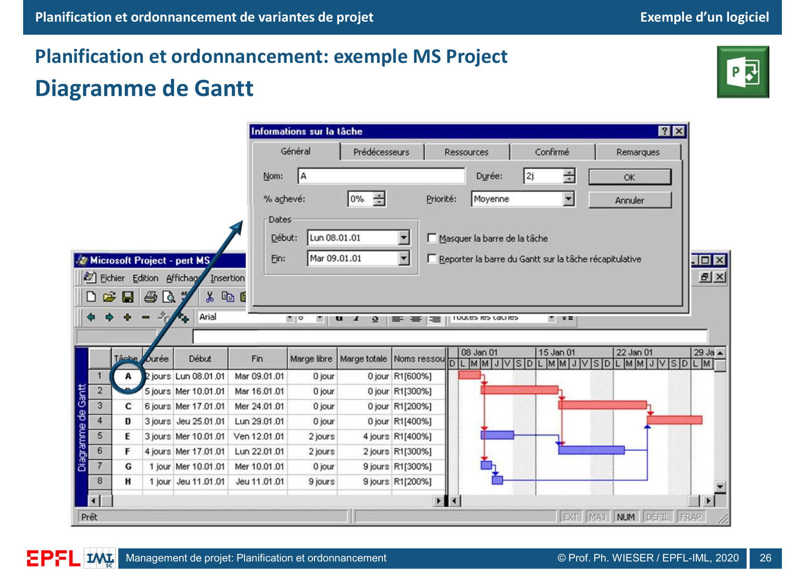

*Figure 7. Diapositive 26. Les dates calendaires et les affectations complètent les durées abstraites. Les marges initiales d'E, F, G et H correspondent à celles du calcul manuel.*[^11]

La vue de ressources colore en bleu l'utilisation jusqu'à la disponibilité paramétrée et en rouge la part en surutilisation. Le pic de 1 000 % correspond à 10 unités à 100 %. La limite paramétrée du logiciel correspond ici à 500 %. La valeur de 5 unités de la charge moyenne est obtenue par un calcul distinct.[^9][^11][^18]

Le Gantt de suivi affiche $C$ à 67 %, $F$ à 50 %, $D$ à 0 % et $A$, $B$, $E$, $G$, $H$ à 100 %. Ce relevé diffère du croquis de la diapositive 23, où $H$ reste à surveiller. Les marges affichées pour les tâches terminées ne correspondent pas toutes à celles du calcul initial. La capture ne précise pas l'unité physique des pourcentages.[^10][^11]

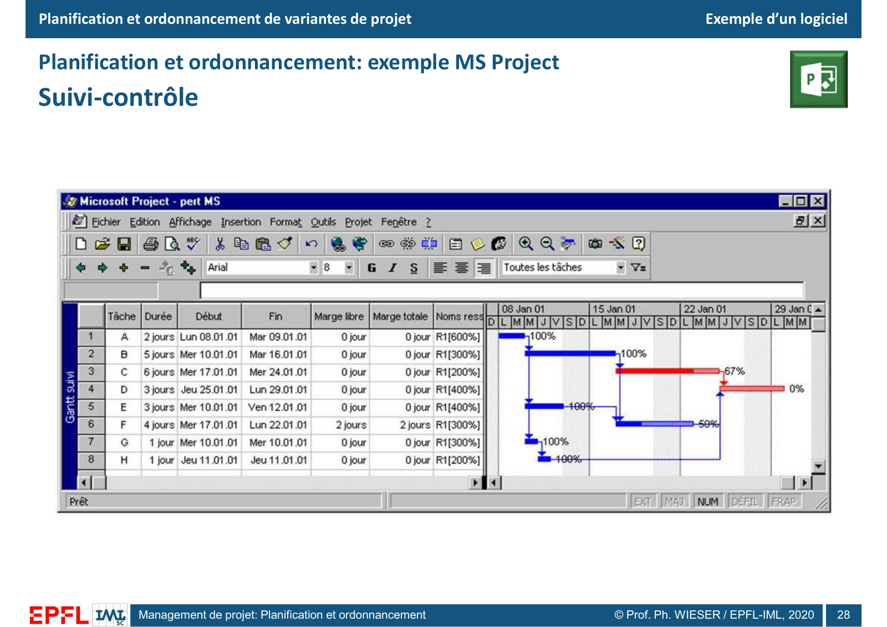

*Figure 8. Diapositive 28. Les pourcentages d'avancement se lisent sur les barres et la table conserve dates, marges et ressources. Les tâches achevées peuvent avoir une autre couleur que celle du chemin critique initial.*[^11]

**Lecture critique.** La capture de Project 2019 juxtapose un Gantt daté d'octobre 2020 et un réseau. La colonne des prédécesseurs de $F$ affiche uniquement le numéro 6, celui de $E$. Le réseau affiché ne porte pas $B\to F$. $F$ débute le lundi 12 octobre, avant la fin de $B$ le mardi 13. Avec le réseau de base et ce calendrier, $F$ devrait attendre le mercredi 14 octobre. La branche $A\to B\to C\to D$ détermine toujours la fin. L'écart vient des dépendances saisies dans cet exemple.[^6][^11]

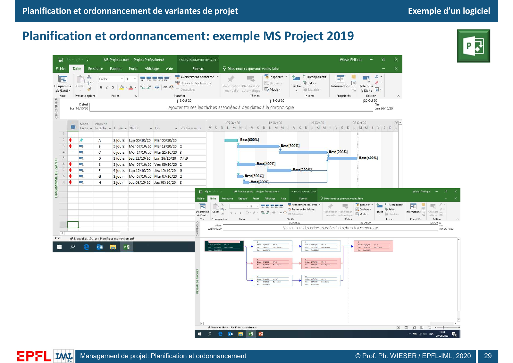

*Figure 9. Diapositive 29. La colonne « Prédécesseurs » permet de vérifier la logique saisie. Une date de fin identique ne garantit pas que les deux réseaux sont les mêmes.*[^11]

## 8. Mesurer le risque de dépasser une date

### 8.1 Durée fixe, distribution et changement de chemin critique

Le support oppose une prévision déterministe avec des durées fixées et une analyse où les durées des activités $A_i$ et $A_j$ sont incertaines. La première donne un point sur l'axe temporel. La seconde donne une distribution de la fin du projet et des marges. Selon les durées réalisées, une autre chaîne d'activités peut gouverner la fin. Les deux indices $x\%$ et $(1-x)\%$ sont schématiques. Ils se complètent si les deux chemins sont les seuls possibles et si chaque réalisation est attribuée à un seul chemin.[^13]

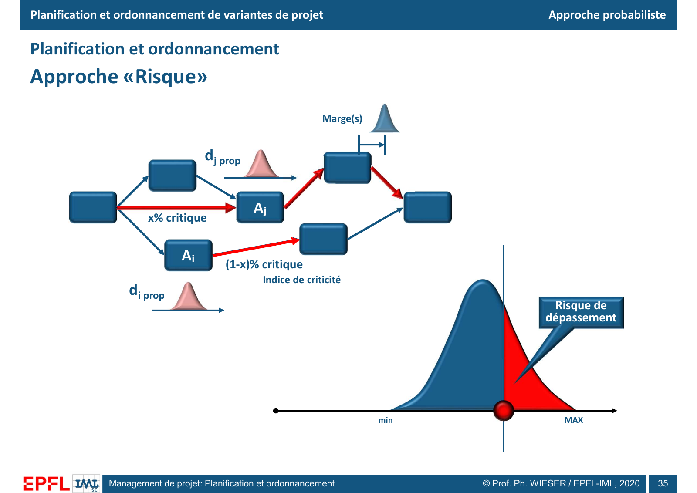

*Figure 10. Diapositive 35. La ligne verticale indique la date cible. L'aire rouge à droite représente la probabilité de finir après cette date. Les petites courbes figurent des distributions de durées ou de marges, sans données ni loi calibrée.*[^13]

**Complément pédagogique.** En PERT classique, les durées optimiste $a$, la plus probable $m$ et pessimiste $b$ donnent une moyenne approchée $(a+4m+b)/6$ et une variance approchée $((b-a)/6)^2$ selon les hypothèses historiques. Avec $(a,m,b)=(2,4,8)$, la moyenne vaut environ $4{,}33$ et l'écart-type environ 1. La moyenne d'un chemin est la somme des moyennes de ses tâches. Pour additionner leurs variances sans terme de covariance, il faut supposer les durées non corrélées. La date de fin du projet est le **maximum** des durées de chemins. L'espérance du maximum peut dépasser le maximum des espérances. La [fiche sur les risques](02-analyse-des-risques.md) relie ce calcul à la simulation et aux scénarios.[^14][^16]

### 8.2 Exemple exact à deux états

**Complément pédagogique calculé.** Dans le réseau A à H, seule $F$ est incertaine. Elle dure 4 unités avec une probabilité de 70 %, ou 8 unités avec une probabilité de 30 %. $F$ débute toujours à 7. Les autres durées sont inchangées. $C$ finit à 13 et $H$ à 4.[^6]

| État de $F$ | Probabilité | Fin de $F$ | Début de $D$ | Fin du projet $T$ | Chemin critique |
|---|---:|---:|---:|---:|---|
| $d_F=4$ | 70 % | 11 | $\max(13,11,4)=13$ | 16 | A–B–C–D |
| $d_F=8$ | 30 % | 15 | $\max(13,15,4)=15$ | 18 | A–B–F–D |

On obtient $\Pr(T>17)=30\%$ et $\mathbb E[T]=0{,}7\cdot16+0{,}3\cdot18=16{,}6$. Le plus petit instant qui couvre au moins 80 % des résultats, le quantile $P80$, vaut 18. Si on remplace $d_F$ par sa moyenne $5{,}2$ avant le calcul, le réseau finit à 16. Cette valeur masque les réalisations où $F$ gouverne la fin. L'indice de criticité de $C$ vaut 70 % et celui de $F$ 30 %. $A$, $B$ et $D$ ont chacun 100 % puisqu'ils appartiennent aux deux chemins.

### 8.3 Estimer les distributions par simulation

Dans un réseau qui contient de nombreuses durées incertaines, la simulation permet de répéter le calcul sous des hypothèses variées.[^16]

1. Vérifiez les dépendances, les contraintes de date, les calendriers et les ressources du planning.
2. Affectez des distributions aux durées incertaines et identifiez les causes communes. Une fermeture de site peut retarder plusieurs tâches ensemble.
3. Pour chaque tirage, recalculez les dates, les marges et les chemins critiques. Représentez la capacité si elle gouverne le planning.
4. Estimez la probabilité de dépassement comme la fraction des tirages où $T$ excède le jalon. Estimez la criticité d'une activité par la fraction des tirages où elle appartient à un chemin critique. Précisez la règle en cas d'égalité.
5. Comparez les quantiles et les scénarios avant et après les mesures étudiées.

L'indice de criticité mesure une fréquence dans le modèle. Une branche rarement critique peut provoquer une dérive importante lorsqu'elle le devient. Comparez aussi le nombre de jours perdus dans les scénarios défavorables et la conséquence pour le jalon.[^13][^16]

## 9. Consolider plusieurs projets

Le dernier schéma superpose des réseaux à une même ligne de lecture pour la ressource $R_i$. On peut agréger les besoins globalement, par période ou à un instant. Sur un même axe temporel, la charge de portefeuille est $\sum_p L_{p,i}(t)$, où $L_{p,i}(t)$ désigne la charge de la ressource $i$ dans le projet $p$ à l'instant $t$.[^20]

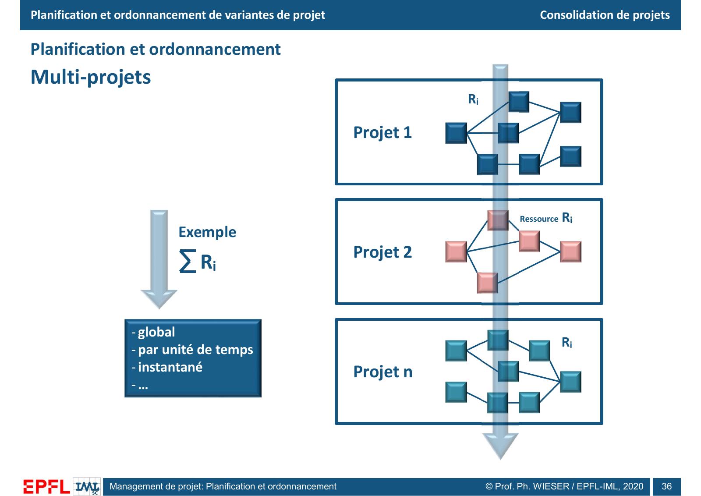

*Figure 11. Diapositive 36. La bande verticale traverse les trois réseaux au même instant. En déplaçant le point de relevé dans le temps, on construit un profil agrégé.*[^20]

**Complément pédagogique.** Deux projets prévoient chacun trois techniciens le mercredi. Si le portefeuille en compte cinq, les deux calendriers respectent peut-être leur réseau propre mais dépassent ensemble la capacité. On peut déplacer une activité dans sa marge, réserver un renfort ou revoir la priorité d'un jalon. Avant d'additionner les besoins, vérifiez que les unités et les compétences sont comparables. Répercutez chaque déplacement sur les successeurs et les prévisions des projets touchés.[^16][^20]

## Questions d'entraînement corrigées

1. **Pourquoi $F$ commence-t-elle à 7 au plus tôt ?** Elle attend $E$, qui finit à 5, et $B$, qui finit à 7. Le plus grand des deux instants est 7.
2. **Calculez les deux marges d'E.** Sa fin au plus tôt est $2+3=5$, son successeur commence à 7 au plus tôt et sa fin au plus tard vaut 9. On obtient $ML_E=2$ et $MT_E=4$.
3. **Comment $G$ peut-elle avoir une marge libre nulle et une marge totale de 9 ?** Le moindre retard de $G$ repousse $H$. Le départ de $D$ peut rester à 13 tant que cette branche finit à temps.
4. **Quel effet aurait une durée de 7 pour $F$, toutes choses égales par ailleurs ?** $F$ finirait à 14 et ferait commencer $D$ à 14. La fin passerait à 17 et $A\to B\to F\to D$ deviendrait critique.
5. **Avec une fin exigée à 15, quelle est la marge totale de $D$ ?** $FT_D=15$, $DT_D=12$ et $Dt_D=13$. $MT_D=-1$. Il faut résoudre l'écart d'une unité pour tenir la date.
6. **Que mesure le +13 de la figure 5 ?** Il additionne les écarts positifs entre la charge au plus tôt et la moyenne de 5. Pour évaluer la faisabilité, comparez à la capacité réelle par case.
7. **Pourquoi recalculer le réseau après un lissage ?** Un déplacement peut pousser les successeurs, réduire leurs marges et concentrer la charge sur une autre période.
8. **Que signifie un indice de criticité de 30 % ?** Dans 30 % des tirages du modèle, la tâche appartient à un chemin qui gouverne la fin. La probabilité de dépasser un jalon se calcule sur la distribution de $T$.
9. **Quel indice explique la date de $F$ dans Project 2019 ?** La colonne des prédécesseurs affiche uniquement $E$ pour $F$. Le lien $B\to F$ a disparu de ce modèle.

## Couverture des 36 diapositives

| Diapo | Sujet ou détail contrôlé | Section |
|---:|---|---|
| 1 | Titre, auteur et millésime imprimé. | Introduction |
| 2 | Variantes, coûts cumulés, marge de manœuvre, analyse des risques et multicritère. | 1.1 |
| 3 | Puzzle, liste, liens, ordonnancement et axe de planification. | 1.2 |
| 4 | Contraintes physiques, administratives, exogènes, de ressources et de sécurité. | 1.2 |
| 5 | Origine de PERT et onze étapes du PERT étendu. | 1.3 |
| 6 | Potentiels-étapes, arc fictif, potentiels-activités et types de lien. | 2.2 |
| 7 | Cases $Dt$, $Ft$, $DT$, $FT$ et durée de la tâche. | 3.1 |
| 8 | Calcul au plus tôt et bornes aval. | 3.2 à 3.4 |
| 9 | Calcul au plus tard depuis la fin. | 3.2 à 3.4 |
| 10 | Marges libres et totales, calcul d'E et notation. | 3.4 |
| 11 | Durée de 16 et chemin A–B–C–D. | 3.3 et 3.4 |
| 12 | Limites de la représentation en réseau et diffusion des marges. | 4 |
| 13 | Gantt au plus tôt, durées et légende des marges. | 4 |
| 14 | Gantt au plus tard, contours au plus tôt et convention de diffusion. | 4 |
| 15 | Catégories de ressources, affectations et conséquences. | 5.1 |
| 16 | Taux de charge, charges par tâche, total 80 et moyenne 5. | 5.1 |
| 17 | Profil au plus tôt construit à partir du Gantt. | 5.1 et 5.2 |
| 18 | Indice +13 et ordre des actions de lissage. | 5.2 et 5.3 |
| 19 | Comparaison des deux profils et indice +11. | 5.2 |
| 20 | Calendriers de projet, de tâche et de ressource. | 6.1 |
| 21 | Borne fixe finale ou intermédiaire, manifestation et logique inverse. | 6.2 |
| 22 | Détail du réseau de la variante retenue pour le suivi. | 1.1 et 7.1 |
| 23 | Relevé, avancement, intervention pour C, F conforme et H à surveiller. | 7.1 |
| 24 | Comité, direction, utilisateurs, procès-verbal, planning et budget. | 7.2 |
| 25 | Réseau sur cinq jours ouvrables dans Project. | 7.3 |
| 26 | Gantt daté, champs d'activité, marges et affectations. | 7.3 |
| 27 | Histogramme de ressource et surutilisation. | 7.3 |
| 28 | Gantt de suivi et valeurs d'avancement. | 7.3 |
| 29 | Project 2019, vues réseau et Gantt, écart sur le lien B→F. | 7.3 |
| 30 | WBS et décomposition top-down. | 2.1 |
| 31 | Agrégation bottom-up et activité hamac. | 2.1 |
| 32 | Quatre vues de regroupement en Gantt hiérarchique. | 2.1 |
| 33 | Fin-début standard et deux formes de décalage. | 2.3 |
| 34 | Date déterministe et distribution de la date de fin. | 8.1 |
| 35 | Marges, indice de criticité et aire de dépassement. | 8.1 à 8.3 |
| 36 | Consolidation d'une ressource par projet, période et instant. | 9 |

## Références

[^1]: Philippe Wieser, *Planification et ordonnancement. Calcul de réseaux*, EPFL-CDM-IML, millésime imprimé 2020, [support de cours](../slides/5_MGT_427_planif_26.pdf), diapositives 1 à 36.
[^2]: Wieser, même support, diapositives 2 à 4. Place de la planification dans l'étude des variantes, puzzle des activités et contraintes.
[^3]: Wieser, même support, diapositive 5. PERT et démarche étendue.
[^4]: Wieser, même support, diapositives 30 à 32. Décomposition, agrégation et exemples visuels.
[^5]: Wieser, même support, diapositives 6 et 7. Formalismes de réseau et légende des dates.
[^6]: Wieser, même support, diapositives 8 à 12. Réseau de base, deux passages et marges. Les valeurs du tableau de la fiche ont été recalculées avec $Ft=Dt+d$.
[^7]: Wieser, même support, diapositives 12 à 14. Gantt au plus tôt et au plus tard, marges et diffusion.
[^8]: Wieser, même support, diapositives 15, 16, 20 et 21. Affectations, charges, calendriers et bornes.
[^9]: Wieser, même support, diapositives 17 à 19. Profils de charge et lissage. Les indices sont reproduits à partir des hauteurs de barres.
[^10]: Wieser, même support, diapositives 22 à 24. Reprise du réseau et suivi-contrôle.
[^11]: Wieser, même support, diapositives 25 à 29. Captures de Microsoft Project.
[^12]: Wieser, même support, diapositive 33. Liens fin-début et schémas de décalage.
[^13]: Wieser, même support, diapositives 34 et 35. Approches déterministe et probabiliste, marges, criticité et dépassement.
[^14]: D. G. Malcolm, J. H. Roseboom, C. E. Clark et W. Fazar, « Application of a Technique for Research and Development Program Evaluation », *Operations Research*, 7(5), 1959, pp. 646 à 669. [Article fondateur PERT](https://pubsonline.informs.org/doi/10.1287/opre.7.5.646).
[^15]: James E. Kelley Jr., « Critical-Path Planning and Scheduling: Mathematical Basis », *Operations Research*, 9(3), 1961, pp. 296 à 320. [Formulation du CPM](https://pubsonline.informs.org/doi/10.1287/opre.9.3.296).
[^16]: U.S. Government Accountability Office, *Schedule Assessment Guide*, GAO-16-89G, 2015. [Guide complet](https://www.gao.gov/assets/gao-16-89g.pdf). Les pratiques 1 à 5 traitent du périmètre, des liens et des ressources, les pratiques 6 à 8 du chemin critique, des marges et du risque, et les pratiques 9 et 10 du suivi et de la référence.
[^17]: Microsoft Support, [types de liaisons entre tâches dans Project](https://support.microsoft.com/en-us/project/link-tasks-in-a-project). La documentation décrit les quatre types de liens, dont le fin-début par défaut.
[^18]: Microsoft Support, [nivellement des affectations de ressources dans Project](https://support.microsoft.com/en-us/project/distribute-project-work-evenly-level-resource-assignments). La documentation décrit le nivellement limité aux marges et les options de fractionnement.
[^19]: Microsoft Support, [règles de calcul des dates et affectations dans Project](https://support.microsoft.com/en-us/project/how-project-schedules-tasks-behind-the-scenes). Sections sur les calendriers, le travail, les unités d'affectation et le type de tâche.
[^20]: Wieser, même support, diapositive 36. Lecture consolidée d'une ressource utilisée dans plusieurs projets.
